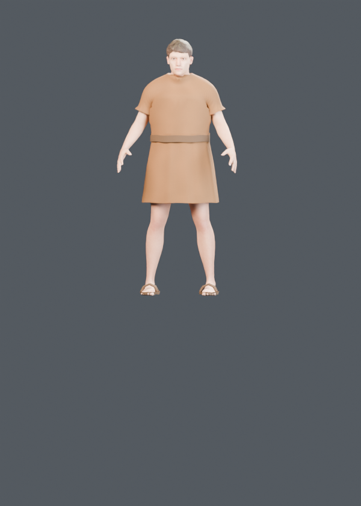
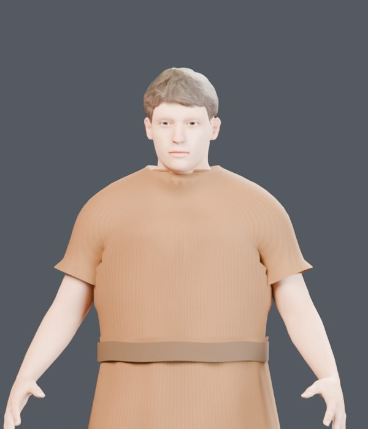
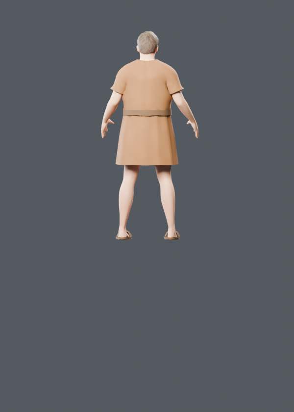
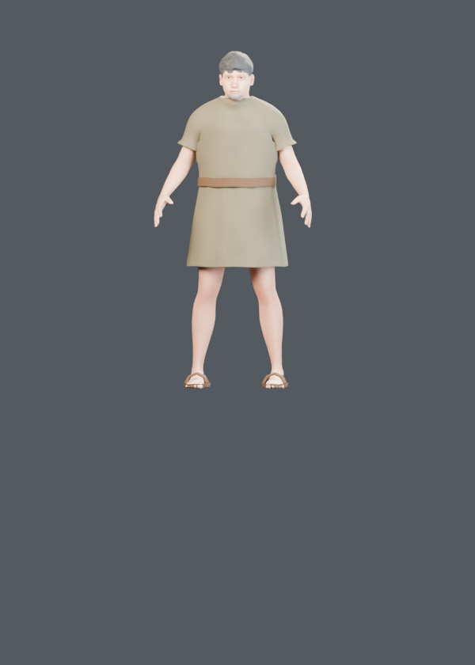
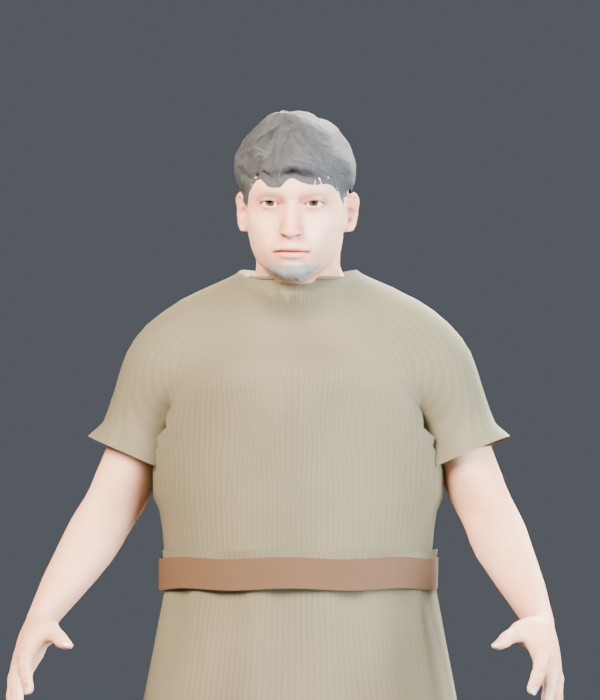
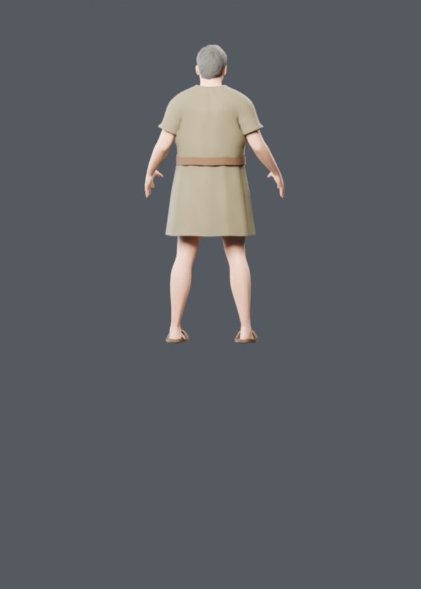

# IMPERATHEN – Figurenatelier

Vorhandene Spielfiguren, tatsächlich in Blender gerendert. Keine neuen Charakterfreigaben.

## Römischer Bürger – erwachsen

[Figur in Blender öffnen](roman-adult/Figur.blend) · [Unverändertes Spielmodell](https://github.com/Ullmann27/Imperathen/blob/2e761e544022d03b0a813ee7cbc0c3f095ce7329/prototype/assets/characters/frontier_civilian_man_0.glb)

## Römischer Bürger – älter

[Figur in Blender öffnen](roman-elder/Figur.blend) · [Unverändertes Spielmodell](https://github.com/Ullmann27/Imperathen/blob/2e761e544022d03b0a813ee7cbc0c3f095ce7329/prototype/assets/characters/frontier_elder_0.glb)

