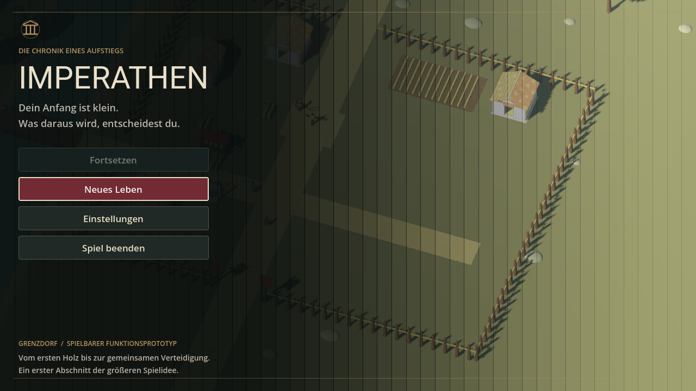
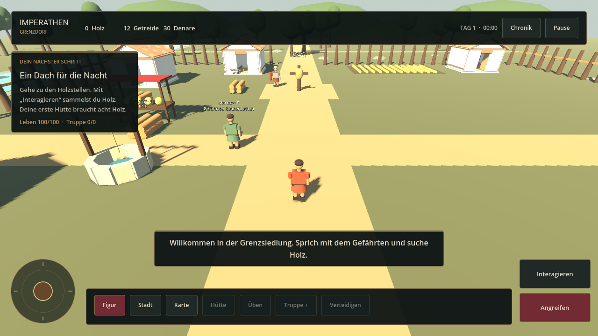
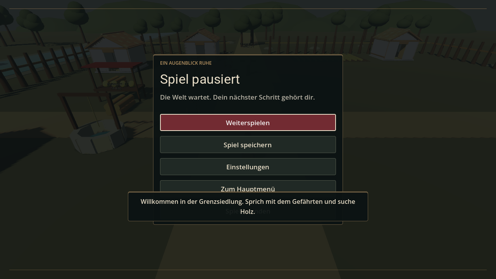

# IMPERATHEN auf Android installieren und spielen

**Aktuelle Integration mit Weltkugel, Talgefecht und Figuren.** [Aktueller APK-Download](https://github.com/Ullmann27/Imperathen/releases/tag/prototype-2026-11-22-a2d321d8) · [Prüfergebnisse](../12_integration/DELIVERY.md). Die folgenden Prüfsummen gehören zur früheren Dorf-Lieferung aus PR #20.

**IMPERATHEN – Grenzdorf ist ein begrenzter 3D-Spielprototyp für Android.** Die Fassung verbindet Holzsammeln, eine eigene Hütte, die Entscheidung über einen Gefährten, Ausbildung, eine kleine Truppe und einen Dorfkampf. Du spielst lokal mit Touch-Steuerung. Zum Spielen brauchst du weder einen PC noch Godot, Blender oder einen KI-API-Schlüssel.

**Bereitstellungsstand: 22.11.2026.** Die ARM64-Test-APK ist tatsächlich gebaut und kryptografisch geprüft. Der zugehörige [GitHub-Lauf](https://github.com/Ullmann27/Imperathen/actions/runs/45038377950) ist vollständig erfolgreich. Eine separate x86_64-Fassung aus denselben Spielquellen wurde unter Android API 35 installiert, gestartet und bedient. Die folgenden Bilder stammen aus diesem tatsächlichen Lauf. Ein Test auf einem physischen ARM64-Telefon steht noch aus.

## Datei und Prüfnachweise

| Angabe | Geprüfter Stand |
| --- | --- |
| Gerätefassung | `IMPERATHEN-0.1.0-arm64.apk` · `arm64-v8a` |
| Dateigröße | 28.698.864 Bytes, rund 28,7 MB |
| App-Name und Paket | IMPERATHEN · `at.heinz.imperathen` |
| Prototypversion | `0.1.0-prototype`, Versionscode 1 |
| Mindest-/Ziel-API laut tatsächlichem Manifest | 24 / 36 |
| APK-Quellcommit | `b3d8e01e64663480d228777a7244a2a882bcac18` |
| Download | [Bauartefakt imperathen-android-12](https://github.com/Ullmann27/Imperathen/actions/runs/45038377950/artifacts/14760940482); darin die ARM64-APK auswählen |
| SHA-256 der ARM64-APK | `0bd67a686c3b5ca59e1ceed9b77a8fc47fa9fa091f00d1b06513c428720457ff` |
| CI-Lauf | [45038377950 – erfolgreich](https://github.com/Ullmann27/Imperathen/actions/runs/45038377950) |
| Android-Emulator | API 35, x86_64; 18 protokollierte Prüfungen bestanden |
| Physisches ARM64-Telefon | Noch nicht getestet |

GitHub nennt für das Bauartefakt den 22.12.2026 als Ablaufdatum. Die Datei ist außerdem dem Projektinhaber direkt bereitgestellt. Für einen späteren Neuaufbau gilt die [Bauanleitung](ANDROID_BUILD.md), insbesondere die Wiederverwendung des zu dieser Lieferung gesicherten privaten Signierschlüssels.

Die Berichte trennen die beiden Architekturen: [ARM64-Paketprüfung](evidence/android/IMPERATHEN-0.1.0-arm64.validation.json), [Bauherkunft](evidence/android/IMPERATHEN-0.1.0-arm64.build.json), [x86_64-Laufzeitbericht](evidence/android/runtime-report.json) und [Quellstand/Prüfungen](evidence/android/engine-validation-report.json). Die unterstützte Prozessorarchitektur und Mindest-API allein garantieren noch keine passende Grafikleistung auf jedem Gerät.

## Installation auf deinem Telefon

Mit der oben bereitgestellten ARM64-Datei:

1. Lade **`IMPERATHEN-0.1.0-arm64.apk`** auf dein Android-Telefon. Falls du ein ZIP-Bauartefakt erhältst, entpacke es zuerst und öffne darin diese APK. Die zusätzliche Datei mit `emulator` im Namen ist für den x86_64-Prüfrechner bestimmt.
2. Öffne die APK im Downloadbereich oder Dateimanager. Android zeigt den Installationsdialog an.
3. Falls Android für diese Quelle noch keine Installationen erlaubt, öffne die im Dialog angebotenen Einstellungen und erlaube die Installation für den verwendeten Browser oder Dateimanager. Die Bezeichnung kann etwa **Unbekannte Apps installieren** oder **Aus dieser Quelle zulassen** lauten; sie hängt vom Gerät ab. Kehre danach zur APK zurück. Das ist die von Android vorgesehene [Installation aus einer anderen Quelle](https://developer.android.com/studio/publish).
4. Prüfe, dass die angebotene App **IMPERATHEN** heißt, und wähle **Installieren**, anschließend **Öffnen**. Bewahre eine abweichende Fehlermeldung mit ihrem genauen Wortlaut auf, damit Geräteanforderung, Signatur oder Installationseinstellung gezielt geprüft werden können.
5. Halte das Telefon im **Querformat**. Den Vorspann kannst du mit **Überspringen** beenden. Wähle **Neues Leben**; später lädt **Fortsetzen** deinen vorhandenen Spielstand.

Die aktuelle Fassung ist eine direkt verteilte Test-APK, kein Eintrag in Google Play oder Galaxy Store. Der Prototyp hat keine eigene Kontoanmeldung und benötigt beim Spielen keine Internetverbindung. Das [Exportpreset](../../prototype/export_presets.cfg) fordert keine Internetberechtigung an.

## Touch-Steuerung

| Du möchtest … | Bedienung im Spiel |
| --- | --- |
| Die Figur bewegen | Linkes Analogpad ziehen; Loslassen stoppt die Bewegung. |
| Die Kamera drehen | Im freien Weltbereich ziehen. |
| Holz sammeln oder mit Marcus sprechen | Zum Ziel gehen und rechts **Interagieren** antippen. |
| Üben oder kämpfen | Rechts **Angreifen** antippen; Bewegung und Angriff können mit verschiedenen Fingern erfolgen. |
| Eine Hütte bauen | **Hütte** wählen und eine freie Stelle im markierten Baugebiet antippen. |
| Einen noch offenen Bauplan verlassen | **Bau abbrechen** oder Android-Zurück. Bereits bestätigte Bauten werden dadurch nicht zurückgenommen. |
| Die Ansicht wechseln | **Figur**, **Stadt** oder **Karte** wählen. |
| Ziele und Ereignisse lesen | **Chronik** öffnen; dabei pausiert die Welt. |
| Unterbrechen oder speichern | **Pause**, anschließend **Spiel speichern** oder **Weiterspielen**. |

**Android-Zurück** schließt zuerst einen offenen Bauplan. Im normalen Spiel öffnet es die Pause; aus der Pause setzt es das Spiel fort. In den Einstellungen führt es zum vorherigen Menü. Eine Geschichte mit offenen Antwortmöglichkeiten wird damit nicht automatisch entschieden. Im Hauptmenü erscheint eine Bestätigung zum Beenden.

Touch-Steuerung ist auf Android standardmäßig aktiv und kann in den Einstellungen umgeschaltet werden. Dort findest du auch UI-Größe, reduzierte Bewegung, Lautstärke und Grafikprofile. Diese Profile sind vorhandene Einstellungen, noch keine bestätigten Leistungszusagen für bestimmte Telefone. Grundlage dieser Bedienbeschreibung sind die [Oberfläche](../../prototype/scripts/ui/game_ui.gd), die [Weltsteuerung](../../prototype/scripts/world/game_world.gd) und die [Spielverknüpfung](../../prototype/scripts/main.gd).

## Dein erster Lebensabschnitt

Du beginnst als zwölfjähriger Junge in einer vorhandenen Grenzsiedlung, ohne eigenes Holz und ohne eigene Hütte. Gehe zuerst zu den Holzstellen. Jede erfolgreiche Interaktion sammelt vier Holz. Für deine Hütte brauchst du acht; wenn du Marcus zusätzlich helfen möchtest, sammle zunächst zwölf.

Marcus wartet am Brunnen. Du kannst vier Holz mit ihm teilen oder ablehnen. Diese Entscheidung bleibt gespeichert und beeinflusst sein Vertrauen. Danach platzierst du deine Hütte auf der erlaubten Baufläche. Kehre mit **Figur** zur persönlichen Ansicht zurück und bleibe nahe der Baustelle: Für diesen Funktionstest sind zwölf Sekunden anwesender Arbeit erforderlich. Während der Pause oder bei zu großer Entfernung geht der Bau nicht weiter.

Nach fertiger Hütte und entschiedener Begegnung kannst du am Übungsplatz die Ausbildung beginnen. Der ausdrücklich gezeigte Zeitsprung **sechs Jahre später** führt in den Erwachsenenabschnitt. Triff das Übungsziel dreimal mit **Angreifen**, jeweils aus gültiger Nähe und nach der Schlagpause. Über **Truppe +** wirbst du anschließend bis zu drei Freiwillige an; jeder kostet fünf Denare und zwei Getreide und fehlt danach als zivile Arbeitskraft.

Mit **Verteidigen** beginnst du das Gefecht gegen drei Gegner nördlich des Dorfes. Nähere dich zum Kämpfen; Schläge außerhalb der Reichweite zählen nicht. Nach einem Sieg entscheidest du zwischen Schutz der Siedlung und Verfolgung. Diese Auswahl verändert den gespeicherten Folgezustand und beendet den vorbereiteten Abschnitt. Erkunden und Speichern bleiben möglich. Eine Niederlage beendet diesen Lebensbogen; im Menü kannst du neu beginnen. Die Regeln stehen im [Weltmodell](../../prototype/scripts/domain/world_model.gd).

## Was diese Fassung bereits enthält und was noch folgt

Vorhanden sind ein Dorfgebiet, ein baubarer Gebäudetyp, begrenzte Ressourcen, eine gespeicherte Gefährtenentscheidung, Ausbildung, höchstens drei eigene Rekruten, eine kleine Kampfbegegnung und der lokale Spielstand. Figuren und große Teile der Umgebung sind einfache Prototypgeometrie. Die Kamera **Karte** zeigt dieselbe Dorfwelt aus größerer Entfernung.

Die große Provinzkampagne, Politik, Handel zwischen Städten, Kaiseraufstieg, umfangreiche Stadtproduktion, große Formationsschlachten und täglich neu erzeugte KI-Geschichten sind noch nicht implementiert. Dieser Abschnitt ist auch noch keine über Wochen ausbalancierte Kampagne und hat keine fotorealistische Grafik. Die [Projekt-README](../../prototype/README.md) beschreibt die aktuellen technischen Grenzen ausführlicher.

## Spielstand, Unterbrechen und Updates

Dein Spielstand bleibt im internen Speicher dieser App. **Fortsetzen** lädt ihn wieder. Du kannst im Pausenmenü speichern; wichtige Entscheidungen, regelmäßige automatische Sicherungen während des Spiels und der Wechsel in den Hintergrund lösen ebenfalls Speichern aus. Ein unterbrochener laufender Kampf wird pausiert und setzt sich bei der Rückkehr nicht unbemerkt fort. Dialoge und Menüs lassen die Simulation ebenfalls ruhen. Eine Sicherungsdatei dient der Wiederherstellung des letzten gültigen Speicherstands; sie ist kein Archiv aller bisherigen Lebensläufe. **Neues Leben** ersetzt nach Bestätigung die aktive Partie.

Es gibt noch keinen komfortablen Spielstandexport und keine Cloud-Synchronisierung. Eine Deinstallation entfernt die appinternen Dateien, also auch den lokalen Spielstand; das entspricht dem [Android-Verhalten für App-Speicher](https://developer.android.com/training/data-storage/app-specific). Deinstalliere die App deshalb nicht vorschnell, um ein fehlgeschlagenes Update zu umgehen.

Für direkt darüber installierbare Updates muss der Entwickler denselben privaten Signierschlüssel verwenden. Der aktuelle CI-Einstiegsbau erzeugt pro Lauf einen neuen Schlüssel. Bis die Wiederverwendung des zu deiner Lieferdatei gehörenden Schlüssels eingerichtet ist, wird die direkte Updatefähigkeit zwischen beliebigen Prüfbauten nicht zugesagt. Die verschlüsselte Sicherung darf öffentlich beim Bauartefakt liegen; privater RSA-Wiederherstellungsschlüssel und eigentlicher Keystore bleiben getrennt privat. Zum Spielen oder Installieren benötigst du diese Schlüssel nicht. Details stehen in der [Bauanleitung](ANDROID_BUILD.md).

## Aussagekraft der Android-Prüfung

Der tatsächliche x86_64-Emulatortest installierte eine separate x86_64-APK aus denselben Spielquellen. Er bestätigte Launcher und Appstart, entfernte den beobachteten Android-Vollbildhinweis anhand der aktuellen Oberfläche, wartete den Vorspann ab und öffnete über einen echten Touch-Tap ein neues gespeichertes Spiel. Android-Zurück erzeugte danach eine neue Spielpause. Der Prozess überstand den Wechsel zum Android-Startbildschirm und die Rückkehr. Im erfassten App-Protokoll gab es keine vom Prüfer erkannten Godot-/Skript-/Shaderfehler oder Absturzmeldungen. Einzelne Android-Systemwarnungen stehen unverändert im vollständigen [Protokoll](evidence/android/logcat.txt).

Diese Laufzeitprüfung umfasst noch keinen vollständigen Android-Durchgang durch Bau, Ausbildung und Kampf. Dieser Spielweg wird zusätzlich durch die tatsächlichen Headless-Integrationstests abgesichert. Ein Emulatorlauf bestätigt keine Ausführung der ARM64-Maschinenbibliothek auf deinem Telefon und keine Bildrate, Wärmeentwicklung oder Akkulaufzeit eines konkreten Geräts.

### Tatsächliche Spielbilder

Menü, Dorf und Pause wurden im Android-Emulator mit 1280 × 720 Pixeln aufgenommen und visuell gesichtet. Die Figuren und Umgebung sind noch vereinfachte Prototypgeometrie. Im Pausebild überlagert die vorübergehende Willkommensmeldung den unteren Menübereich; diese bekannte kleine UI-Schwäche ist für die nächste Überarbeitung dokumentiert. Die Bilder werden daher nicht als vollständige optische Endabnahme bezeichnet.

