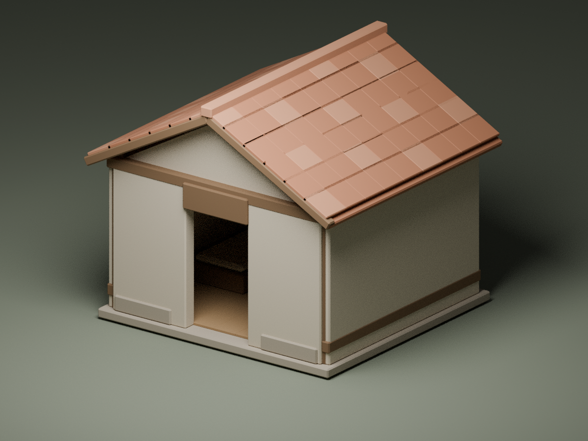

# Ausführungs- und Prüfnachweis

**Stand: 22.11.2026.** Dieser Bericht beschreibt die tatsächlich ausgeführte erste Godot-Lieferung unter `prototype/`. Die ältere Projektmappe, Konzeptbilder und Planungs-Abnahmematrix sind davon getrennte Quellen.

## Ergebnis des abschließenden Prüflaufs

Ausgeführt im Repository:

```sh
python3 tools/check_prototype.py
```

Engine: **Godot 4.7.2.stable.official.ed1daf0bf**. Alle sechs Schritte endeten mit Exitcode 0 und dem vorgesehenen Erfolgsmarker, soweit ein Marker vorgesehen ist. Der abschließende Lauf enthält keine erfassten Enginefehler oder Warnungen. Vollständige Ergebnisse und Quellprüfsummen: [validation_report.json](evidence/validation_report.json).

| Schritt | Tatsächlicher Umfang | Nachweis |
| --- | --- | --- |
| Ressourcenimport | Projekt und vorhandene GLB-/WAV-Ressourcen durch die Engine importiert | [import.log](evidence/import.log) |
| Regeln und Speicherung | 12 Prüfsuiten, **326 Assertions**: atomare Regeln, Reichweiten, Bilanzen, Zeit, Alter, Sieg/Niederlage, Save/Backup und Fehlerinjektion | [domain.log](evidence/domain.log) |
| Oberfläche und Touch | **115 Prüfungen**, darunter native Touchereignisse, zwei Finger, Fokusverlust, Android-Zurück, App-Hintergrund, Safe Area, Settings, Dialogrückwege und Größenwechsel | [ui.log](evidence/ui.log) |
| Welt | Echte Bewegung, Kollision, Kamerawechsel, Bautaps, Modellimport, Wiederaufbau und Grafikprofile | [world.log](evidence/world.log) |
| Gesamtablauf | **32 Prüfungen** vom realen Einstieg über UI/Weltbefehle bis Kampfentscheidung, Backup-Laden und App-Pause | [integration.log](evidence/integration.log) |
| Hauptszene | Tatsächlicher Start von main.tscn; 420 Simulationsframes ohne Skriptfehler | [main_scene.log](evidence/main_scene.log) |

Die Zahlen beschreiben Prüfungen in einem kleinen Prototyp. Sie sind keine Garantie allgemeiner Fehlerfreiheit und kein Test einer späteren Großkampagne.

## Was die Prüfungen konkret absichern

Der Regelkern lehnt unvollständige, unbekannte und nicht endliche Eingaben ab. Abgelehnte Vorgänge verändern Ressourcen oder Fortschritt nicht teilweise. Wiederholte erfolgreiche Befehlskennungen buchen denselben Vorgang nicht erneut; dieselbe Kennung mit anderem Inhalt wird abgewiesen. Materialverbrauch, zivile Arbeitskräfte, Soldaten, Verluste und Belohnungen werden auf zusammenpassende Bilanzen geprüft.

Baustellen benötigen anwesende Arbeit. Zwei nahe Baustellen verdoppeln nicht die Arbeitszeit einer einzelnen Figur. Halbfertige Baustellen bleiben über Save/Load erhalten. Ein Zeitsprung beginnt erst nach vollständigem Abschluss offener Baustellen und berücksichtigt Figur und Gefährten gemeinsam. Kampfbelohnungen verlangen tatsächliche besiegte Gegner, Verluste sind persistent, ein terminaler Tod bleibt nach dem Laden terminal.

Saveprüfungen umfassen unvollständige Dateien, unbekannte Versionen, ungültige Felder, Prüfsummenfehler, widersprüchliche Ressourcen, sichere Backupwahl, vorzeitig liegengebliebene temporäre Dateien und Schreibfehler. Laden übernimmt erst den vollständig validierten Zustand. Prüfsummen sind ausdrücklich kein Manipulationsschutz gegen den Dateiinhaber.

Die UI-Prüfungen senden `InputEventScreenTouch` und `InputEventScreenDrag` über Godots Viewport. Nachgewiesen sind gleichzeitiges Bewegen und Angreifen mit zwei Fingern, Loslassen außerhalb der Padfläche und Rücksetzen bei Dialog, Moduswechsel oder Fokusverlust. Layoutgrenzen wurden bei **1280×720, 960×540 und 1200×900**, jeweils mit **125 % UI-Skalierung**, rechnerisch im tatsächlichen UI-Baum geprüft. Das ersetzt keine optische Sichtung auf einem Handy.

Die Weltprüfungen führen `CharacterBody3D`-Bewegung und Kollision aus. Sie prüfen eine Palisadenbarriere, Ortserhaltung bei Kamerawechseln, Reichweite von Interaktionen, gültige und ungültige Bautaps und korrektes Entfernen alter Gebäude beim erneuten Aufbau. Die Grafikprofile ändern echte Engine-Einstellungen, ohne maßgebliche Weltdaten oder Kollisionskörper zu ändern.

Der Integrationstest nutzt die tatsächliche Hauptszene. Er sammelt Holz durch den UI-/Weltpfad, trifft die Gefährtenwahl, platziert eine bezahlte Hütte durch einen ScreenTouch-Bautap, prüft pausierte Bauarbeit, absolviert die Ausbildung, wirbt drei Freiwillige an, schlägt tatsächliche Gegner über die Weltaktionen und trifft die Folgeentscheidung. Anschließend beschädigt er gezielt die Test-Hauptdatei und lädt die gültige Sicherung. Der Test prüft auch die Betriebssystem-Benachrichtigung für App-Pause, die Simulation anhält und einen gültigen Stand schreibt.

## Während der Integration gefundene und behobene Fehler

- **Zahlen nach JSON-Laden:** Ein wiederholter gespeicherter Befehl lieferte zunächst JSON-Fließkommazahlen statt der erwarteten ganzen Zahlen. Schemagebundene Normalisierung und Replaytest sichern den korrigierten Pfad.
- **Storykennung:** Das strenge Modell besitzt keine separate story.id. Die Integration verwendet deshalb eine stabile Inhaltskennung, damit der Siegdialog tatsächlich erscheint.
- **Abgewiesene Storyauswahl:** Ein ungültiger Auswahlwert konnte zunächst die bestehende Auswahl schließen. Der Dialog öffnet jetzt erneut mit den weiterhin gültigen Optionen; der Integrationstest prüft diesen Fall.
- **Doppelter Todessave:** Die Dialoganzeige hatte eine unerwünschte Schreibnebenwirkung. Speichern erfolgt nun über den erfolgreichen Befehl, während bloßes Anzeigen und Laden den Backupstand nicht erneut drehen.
- **Erste Speicherung:** Eine Willkommensmeldung überdeckte den ersten Schreibfehler. Sie wird jetzt nur nach erfolgreichem Speichern gezeigt.
- **Bauabbruch über Escape:** Die UI fing Escape zunächst als Pause ab. Ein aktiver Bauplan wird jetzt zuerst abgebrochen; ein eigener UI-Test prüft die Reihenfolge.
- **Audioprüfung ohne Gerät:** Der Dummy-Audiotreiber hielt im schnellen Headless-Lauf zwei Wiedergabeobjekte bis nach Szenenende. Logiktests starten daher bewusst keine Audiowiedergabe; für reale Szenen wurde zusätzlich explizite Audiofreigabe ergänzt. Ein tatsächlicher Hörtest bleibt offen.
- **Blender-Denoising:** Der installierte CPU-Build enthält kein OpenImageDenoise. Der Assetrender verwendet deshalb 48 Samples ohne diesen optionalen Baustein.

## Echte Blender-Arbeit

Blender **4.3.2** hat das Originalmodell erzeugt, als GLB exportiert und einen CPU-Render erstellt. Die Quelle liegt in [`art/source/frontier_hut.blend`](../../art/source/frontier_hut.blend), das Werkzeug unter [`tools/build_frontier_hut.py`](../../tools/build_frontier_hut.py).

Das Modell enthält **8 Materialbatches und 6.450 Dreiecke**, seine GLB-Datei ist **497.340 Bytes** groß. Godot hat das Asset instanziiert und Abmessungen von rund **4,387 × 3,74 × 4,24 Metern** gemessen. Das Manifest dokumentiert Herkunft und Hashes. Diese Angaben beschreiben nur das einzelne Asset, kein Leistungsbudget einer großen Stadt.



Das Bild ist ein Assetrender und **kein Ingame-Screenshot**. Es wurden keine fremden Spielmodelle oder Texturen verwendet. Der Umgebungston entstand ebenfalls lokal durch eigene Synthese. Die optionale Draco-Kompressionsbibliothek fehlt im Blender-Build; der unkomprimierte GLB-Export wurde erfolgreich importiert und verwendet.

## Grenzen der Ausführung

Godot wurde mit seinem **Headless-/Dummy-Renderer** ausgeführt. Der Versuch, für ein echtes Enginebild eine grafische Anzeige bereitzustellen, scheiterte an der fehlenden lokalen Displaymöglichkeit: Xorg konnte keine erforderlichen lokalen Listening-Sockets anlegen. Es wurde keine Sicherheitsgrenze umgangen. Der Blender-CPU-Render funktioniert unabhängig davon.

Damit sind folgende Punkte weiterhin **nicht** nachgewiesen:

- Ingame-Screenshot, vollständige optische Abnahme und hörbare Audioausgabe.
- Exportiertes Android-APK, echter Handydurchlauf, sichere Bildschirmränder und Verhalten auf konkreten Mobilchips.
- Bildraten, Stromverbrauch, thermisches Verhalten oder Massenschlachtleistung.
- Windows-/Konsolenexport und Produktions-Unreal-Lauf.
- Vollständige Provinzkarte, Politik, Handel zwischen Städten, Kaiserkarriere, generative KI-Geschichte oder Wochenkampagne.

Die Headless-Testzeiten im JSON-Report sind Laufzeiten der Prüfprogramme und dürfen nicht als Spiel-FPS ausgegeben werden.

## Wiederholbarkeit und Dateien

Der Prüfläufer verwendet wegwerfbare XDG-Daten-, Konfigurations- und Cacheverzeichnisse, damit echte Spielstände unangetastet bleiben. Er prüft neben Exitcodes auch Fehlertexte und Erfolgsmarker, weil ein Godot-Skriptfehler nicht in jedem Fall einen passenden Prozessfehlercode liefert. Der Report enthält SHA-256-Werte der geprüften Spielquellen und Assets.

Weitere Arbeit folgt [NEXT_AGENT.md](NEXT_AGENT.md). Als nächster belastbarer Nachweis ist ein grafischer Durchlauf beziehungsweise ein echter Android-Gerätetest sinnvoll; zusätzliche simulierte Testzahlen ersetzen ihn nicht.
