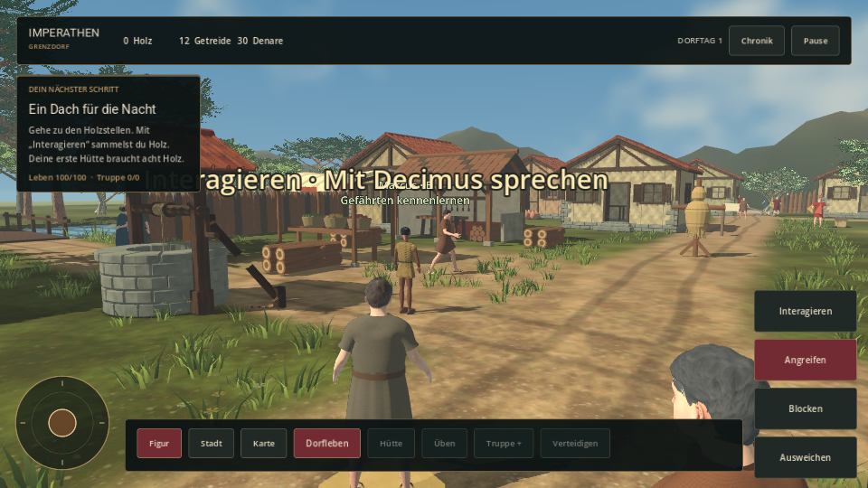
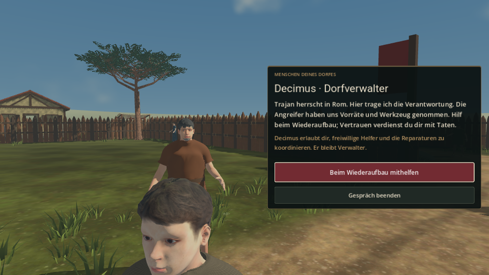
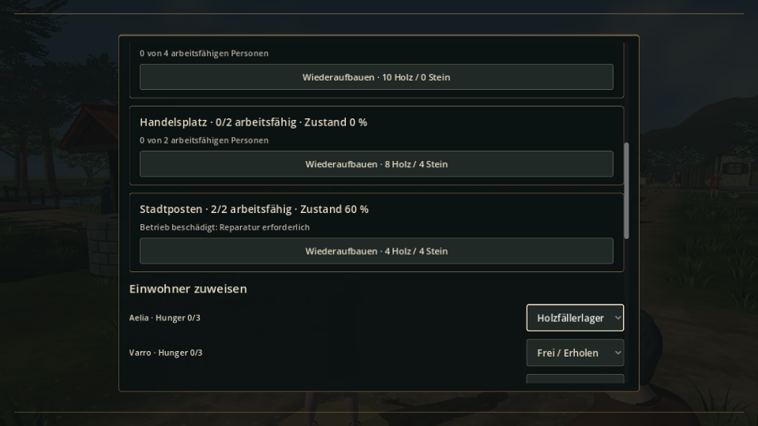

# Tatsächliche Android-Aufnahmen · Lauf 25

Alle 14 Bilder stammen unverändert aus dem erfolgreichen Lauf von Commit `e1b1c1fb16d63056e4eb80891d84ed75c79b4ed6`.
Dateiprüfsummen und Pixelmaße wurden gegen den tatsächlichen Laufzeitbericht abgeglichen.
Das Bild des ARM64-Intros belegt den Start unter Übersetzung; die übrigen Bilder gehören zum x86_64-Emulatorlauf.
Es handelt sich um Spielbilder des Prototyps und um keinen physischen Telefontest.

| Aufnahme | Ansicht | Größe |
| --- | --- | --- |
| [00_android_intro.png](screenshots/00_android_intro.png) | Intro | 960 × 540 |
| [01_android_menu.png](screenshots/01_android_menu.png) | Hauptmenü | 960 × 540 |
| [10_android_opening.png](screenshots/10_android_opening.png) | Filmischer Einstieg | 960 × 540 |
| [11_android_opening_objective.png](screenshots/11_android_opening_objective.png) | Zielkarte | 960 × 540 |
| [12_android_decimus.png](screenshots/12_android_decimus.png) | Gespräch und Arbeitserlaubnis | 960 × 540 |
| [13_android_work_assignment.png](screenshots/13_android_work_assignment.png) | Tatsächliche Arbeitszuweisung | 960 × 540 |
| [02_android_world.png](screenshots/02_android_world.png) | Dorf und Touchsteuerung | 960 × 540 |
| [03_android_pause.png](screenshots/03_android_pause.png) | Pause | 960 × 540 |
| [04_android_valley.png](screenshots/04_android_valley.png) | Talgefecht | 960 × 540 |
| [09_android_marching.png](screenshots/09_android_marching.png) | Truppenbewegung | 960 × 540 |
| [05_android_valley_square.png](screenshots/05_android_valley_square.png) | Talgefecht im quadratischen Fenster | 920 × 900 |
| [06_android_globe.png](screenshots/06_android_globe.png) | Weltkugel | 920 × 900 |
| [08_android_figuren.png](screenshots/08_android_figuren.png) | Figurenansicht | 920 × 900 |
| [07_android_arm64_translated_intro.png](screenshots/07_android_arm64_translated_intro.png) | ARM64-Start unter Übersetzung | 920 × 900 |

## Dorf

## Decimus

## Arbeitszuweisung

Die Oberfläche und Nahansichten bleiben Prototypdarstellung. Der [Laufzeitbericht](IMPERATHEN-e1b1c1fb-Emulatorpruefung.json) dokumentiert die jeweiligen Eingaben, Zustände und Bildprüfsummen.
