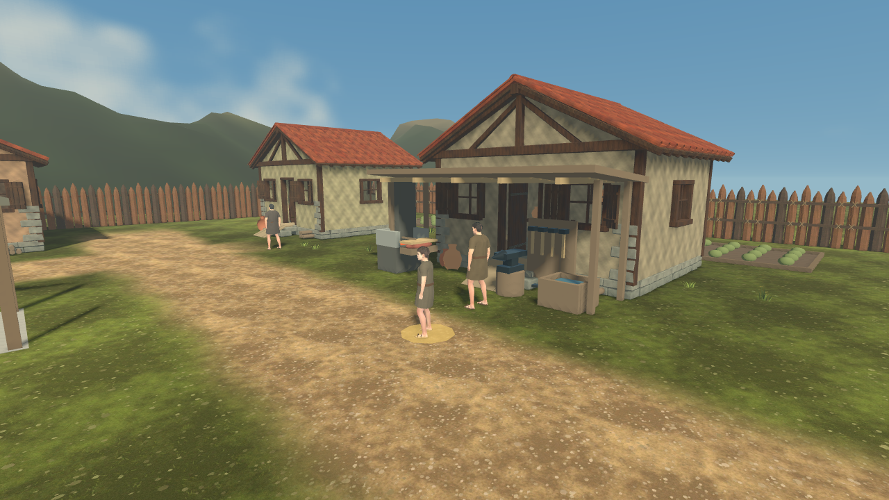
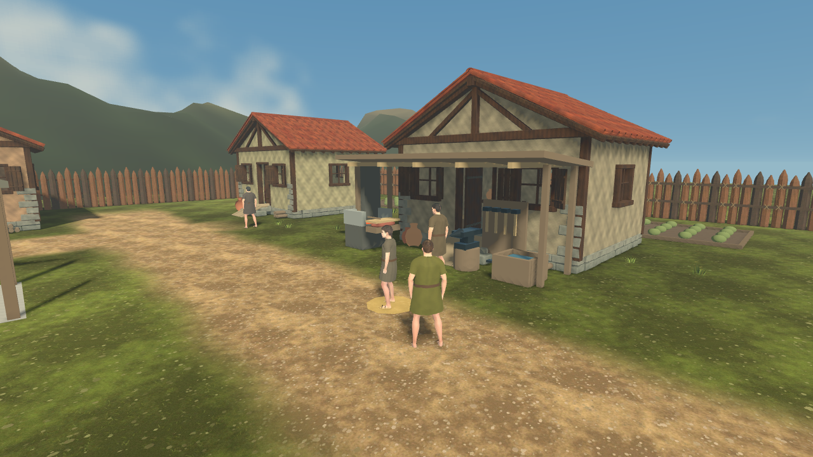
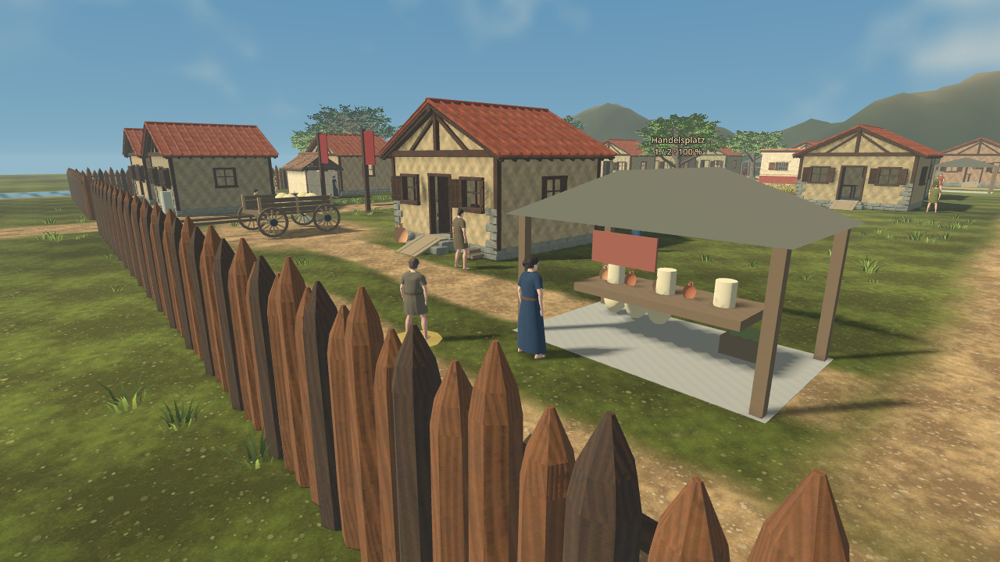
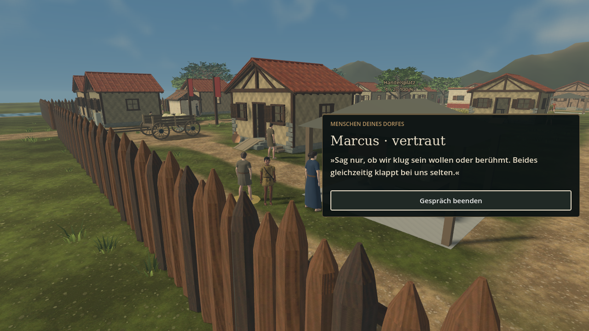

# AP-1 und AP-2 · Lieferung und Nachweise

Stand: 24.11.2026. Deutschsprachige Umsetzung für Godot 4.7.2,
Android zuerst, Renderer `gl_compatibility`.

## Stand und Revisionen

Die beiden Arbeitspakete sind auf dem eigenen Branch
`feature/ap1-ap2-companions-20261124` umgesetzt. Der
[Entwurfs-PR #53](https://github.com/Ullmann27/Imperathen/pull/53) richtet sich
gegen `handoff/sol-20261124`. Der Handoff und `main` wurden nicht verändert.

| Revision | Inhalt |
|---|---|
| `94bb7cdd76a3fe2577610eac8da6948e29b0faab` | Unveränderter Handoff und visuelle Vergleichsbasis |
| `e6854ee3b7b76b415768d8e97ad31d53afc0b625` | AP-2: neun Brückenschritte in sieben Missionsdateien |
| `a79ec2e225aca5baa6fe54e33dcbea89285ae782` | AP-1: physische Begleiter, belegte Zeilen und Regressionen |
| `0ecf49870da1e3389a47f3143dd6aa06b68c0db7` | Importprovenienz für den reproduzierbaren Bildvergleich; Spielcode unverändert |

Die auf GitHub gesicherten Dateibäume stimmen bytegenau mit den lokal geprüften
Implementierungsständen überein: AP-2 Tree
`becc7bad6965af7bb9a7a72c8a561573c7f16289`, AP-1 Tree
`47d69905e9d14b2dd16a8d3992e40f8d558079c4`.

## Ergebnis im Spiel

- Silvanus begleitet den Spieler in I-04 zur Schmiede. Die Lehrlings-Erlaubnis
  wird am tatsächlichen neuen Standort angesprochen.
- Marcus folgt in I-06, I-08 und I-09. Die bestehenden Figuren bewegen sich mit
  Körperkollision und Bodenprüfung; sie erreichen definierte Haltepunkte und
  pausieren während Gesprächen beziehungsweise Menüs.
- Die I-03-Entscheidung wählt am Markt eine von zwei belegten Originalzeilen.
  In I-08 und I-09 gibt es jeweils eine belegte Zeile mit unterschiedlicher
  Textregie. Eine zusätzliche Vertonung wurde nicht erstellt.
- I-07 zeigt den **Wachmann**. Die alte technische Kennung `severus` bleibt
  bestehen, damit Beziehungen und Spielstände nicht umbenannt werden müssen.
- I-02, I-08 und I-10–I-14 laden ihre bisherigen Brückendaten aus Missionsdateien.
  Auslösung, Priorität, Reihenfolge und Auswirkungen bleiben erhalten.

Details: [`AP1_BEGLEITER.md`](AP1_BEGLEITER.md) und
[`AP2_DATEN.md`](AP2_DATEN.md).

## Quellen und Ergänzungen

Die vier Original-DOCX wurden geprüft. Die für dieses Paket verwendeten
Band-1-Fundstellen sind:

| Gegenstand | Originalfundstelle |
|---|---|
| Silvanus begleitet zur Schmiede | I-04, Tabelle 7, Besetzung/Storykern; Dialogregie Zeile 01 |
| Marcus am Markt | I-06, Tabelle 9; Dialogregie Zeilen 05 und 08 |
| Marcus bei den Hufspuren | I-08, Tabelle 11; Dialogregie Zeile 01 |
| Marcus beim Abendauftrag | I-09, Tabelle 12; Dialogregie Zeile 04 |
| Freund/Rivale beeinflusst Ton | I-03, Tabelle 6; Gameplay → Konsequenzen und Dialogverzweigung |
| Rollenname des kranken Wachmanns | I-07, Tabelle 10 und Missionsabschnitt; Volltextsuche aller vier Bände |

Für den Eigennamen „Severus“ gibt es in den vier Originalen keinen Treffer.
Die Quellen identifizieren Decimus nicht als den kranken Mann. Deshalb wurde
die vorhandene Figur als namenloser Wachmann erhalten, statt sie ohne Beleg mit
Decimus zusammenzulegen.

Folgeabstände, Suchbudget, Haltekoordinaten, Zuordnung zu Teilschritten und
Auswahlregeln für die Originalzeilen sind als **Ergänzung** dokumentiert.
Die vollständige Quellenprüfung mit Originaldatei-Hashes steht in
[`QUELLENPRUEFUNG.md`](QUELLENPRUEFUNG.md). Originaldrehbücher und ihre
Volltextextraktionen sind nicht im Repository.

## Tatsächlich ausgeführte Tests

| Stand | Python-Tests | Engine-Prüfgruppen |
|---|---:|---:|
| Unveränderter Handoff | 153/153 | 61/61 |
| AP-2 separat | 153/153 | 62/62 |
| AP-1 und AP-2 zusammen | 153/153 | 64/64 |
| Einschließlich 14 zusätzlicher Tests für die Bildkontrolle | 167/167 | 64/64 |

Alle Läufe verwendeten `4.7.2.stable.official.ed1daf0bf`. Der letzte
Implementierungslauf meldete keine Fehler und keine Warnungen.

```bash
python3 -m unittest discover -s tests -p 'android_*_test.py'
python3 tools/check_prototype.py \
  --godot /opt/godot/4.7.2/Godot_v4.7.2-stable_linux.x86_64 \
  --keep-going --report <eigenes-nachweisverzeichnis>
```

| Gezielter Nachweis | Erfolgreiche Einzelprüfungen | Aussage |
|---|---:|---|
| Begleitnavigation | 30 | Wand, Bewohner, Bodenlücke, Hausrampe, bewegtes Ziel, Abstand, Pause und Zielwechsel |
| Reale Dorf-/Dialogintegration | 269 | Alle vier Orte, vorhandene Figurenanzahl, wirkliche Position, Pause, Dialognähe, Save/Load und andere Karriere |
| Band-1-Abgleich | 206 | Quellenzeilen, Namen, stabile IDs und isolierte Datenansichten |
| Brückendaten | 214 | Unveränderte Brücken, IDs, Übergaben, Selektorfälle und Handoff-Saves |
| AP-2 vor den AP-1-Textkorrekturen, Modus `--exact-runtime` | 215 | Zusätzlich alle Felder der 35 Stammschritte bytegleich |

Vollständiger Engine-Bericht mit Quellhashes und allen Gruppenlogs:
[`evidence/ap1/`](evidence/ap1/). Python-Protokoll:
[`evidence/ap1_python.log`](evidence/ap1_python.log).
Der gesonderte AP-2-Bytevergleich und seine älteren Testberichte liegen daneben.
Die zusätzlichen Prüfungen und der erneute vollständige Engine-Lauf stehen in
[`evidence/review_fix_python.log`](evidence/review_fix_python.log) und
[`evidence/review_fix_engine_report.json`](evidence/review_fix_engine_report.json).
Vor dem abschließenden Nachweis-Commit wurden beide Pflichtbefehle nochmals
ausgeführt: **167/167 Python-Tests und 64/64 Engine-Gruppen, ohne Warnungen**.
Die abschließenden Protokolle sind
[`evidence/final_python.log`](evidence/final_python.log) und
[`evidence/final_engine_report.json`](evidence/final_engine_report.json).

Zusätzlich bestanden auf `0ecf498` die bestehenden
GitHub-Prüfungen:

- [Foundation checks](https://github.com/Ullmann27/Imperathen/actions/runs/45434183102)
- [Story and cinematic contract](https://github.com/Ullmann27/Imperathen/actions/runs/45434183268)
- [NPC and animated asset regressions](https://github.com/Ullmann27/Imperathen/actions/runs/45434183170)

## Vorher/Nachher: neun echte Bildpaare

Der grafische [Prüflauf 45434162620](https://github.com/Ullmann27/Imperathen/actions/runs/45434162620)
ist erfolgreich abgeschlossen. Er vergleicht den unveränderten Handoff
`94bb7cd` mit `0ecf498`: **18 originale PNG-Aufnahmen, neun passende Paare,
keine Vergleichsfehler**. Der Basislauf bestand 107, der neue Lauf 131
Prüfungen. Die anschließend hinzugefügten Nachweisdateien verändern den
gerenderten Spielcode nicht.

Je Paar wurden Kamera einschließlich Transformation, Spielerposition,
Auftragsschritt, I-03-Entscheidung, Fortschrittshash, Auflösung 1280 × 720,
Qualitätsprofil und Aufnahme-Pose verglichen. Beide Stände verwenden dasselbe
externe Prüfszenenskript und echte `GameWorld`-/`GameUI`-Ansichten. Die Aufträge
laufen über die Modellbefehle; die Anreise des Spielers ist eine dokumentierte
Testvorgabe. Die Begleiter erreichen ihre neuen Orte durch die echte
Physikbewegung. Dies ist kein aufgezeichneter vollständiger Spieldurchlauf.

Die Beleuchtung und Präsentationszeit sind für den Vergleich festgesetzt.
Deshalb bezeichnet „Abend I-09“ den Auftragsschritt und keinen Nachweis einer
neuen Abendbeleuchtung. Bei den drei neuen Marcus-Dialogen ist im Vorher-Bild
kein entsprechendes Dialogfenster vorhanden, weil der bisherige Marcus am
anderen Ort steht und diese Begleitdialoge noch fehlen.

Alle Bilder wurden einzeln angesehen. Ergebnis der Sichtprüfung:

| Bildpaar | Beobachtung |
|---|---|
| Schmiede I-04 | Silvanus steht jetzt vor der Schmiede; Sextus, Spieler und Umgebung bleiben sichtbar. |
| Markt I-06 | Marcus steht jetzt beim Spieler am Markt; keine neue sichtbare Überschneidung mit Stand oder Palisade. |
| Markt I-06, Freunddialog | Titel „Marcus · vertraut“ und die belegte Zeile sind vollständig lesbar. |
| Wachmann I-07 | Titel und Schaltfläche verwenden „Wachmann“; Kamera, Figur und bestehender Dialogaufbau sind gleich. |
| Nordweg I-08 | Marcus steht neben dem Spieler am Spuren-Ort; kein sichtbares Eindringen in das benachbarte Haus. |
| Abend I-09 | Marcus steht am Familienauftrag; die teilweise Sichtverdeckung des Spielers durch das vorhandene Haus ist bereits im Vorher-Bild vorhanden. |
| Abend I-09, Dialog | Die belegte Zeile und die Schaltfläche passen vollständig in das Dialogfenster. |
| Markt I-06, Rivalenpfad | Marcus ist auch nach der Rivalenentscheidung am vorgesehenen Ort. |
| Markt I-06, Rivalendialog | Titel „Marcus · zurückhaltend“ und die andere belegte Marktzeile sind vollständig lesbar. |

In diesen Ansichten wurde keine neue auffällige Bodenablösung, neue sichtbare
Gebäudeüberschneidung oder abgeschnittene Dialogschrift erkannt. Die Prüfung
bewertet die eingeführten Änderungen im bestehenden Grafikstil. Sie beweist
weder jede mögliche Laufanimation noch eine vollständige grafische Fehlerfreiheit.

### Silvanus an der Schmiede

| Vorher · Handoff | Nachher · AP-1/AP-2 |
|---|---|
|  |  |

### Marcus am Markt mit Freunddialog

| Vorher · Handoff | Nachher · AP-1/AP-2 |
|---|---|
|  |  |

Alle neun Vergleiche stehen in
[`evidence/visual/comparison.html`](evidence/visual/comparison.html),
die maschinelle Prüfung in
[`comparison.json`](evidence/visual/comparison.json) und die Sichtbewertung in
[`SICHTPRUEFUNG.json`](evidence/visual/SICHTPRUEFUNG.json).
Die Originalbilder sowie Import- und Laufprotokolle sind mitgesichert.
Der heruntergeladene Artefakt-ZIP wurde vor dem Entpacken per SHA-256 geprüft;
die Quittung steht in
[`artifact_receipt.json`](evidence/visual/artifact_receipt.json).

Der Aufnahme-Renderer war `gl_compatibility` auf **llvmpipe/Mesa unter Xvfb**,
also ein Desktop-Software-Renderer. Der erfolgreiche Lauf ist kein
Android-Leistungsnachweis. Die korrigierte Importprüfung hat im Basislauf
294 neu extrahierte Texturen direkt gegen ihre unveränderten GLB-Quellen
geprüft. Die Quellen blieben während beider Aufnahmen unverändert. Einzelheiten
zum ersten abgebrochenen Lauf und zur Korrektur stehen in
[`BILDPRUEFUNG.md`](BILDPRUEFUNG.md).

## Spielstände

Schema **v5 mit Envelope**, Kindheitsversion und `screenplay.version = 3`
bleiben erhalten. Kein Schritt und keine Actor-ID wurde umbenannt. Die neue
Regie führt keine zusätzlichen gespeicherten Begleitfelder ein.

Die bestehenden NPC-Beobachtungen tragen die realen Positionen. Marcus' bisherige
Mittelpunkt-Konvention bleibt kompatibel; die Umrechnung auf den Fußursprung
geschieht beim Laden. Normaler State-Sync setzt den Begleiter nicht zurück.

Drei vor der Änderung im tatsächlichen Handoff aufgezeichnete v5-Envelopes
werden geladen, fortgesetzt und erneut gespeichert. Zusätzlich sichern die
Weltprüfungen Begleiter an allen vier Orten und laden sie am selben Standort
wieder. Die vorhandenen Migrationstests bleiben grün.

## Grenzen und nächster Schritt

Der Nachweis umfasst den vorhandenen Dorfprototyp und diese beiden Arbeitspakete.
Er belegt keine vollständig inszenierte Band-1-Kampagne und keine 90 Stunden
Spielzeit. Die restlichen Bände werden durch AP-1/AP-2 noch nicht spielbar.

Android-Geräteleistung, Frametimes unter Dauerlast, Wärme und Touch-Bedienung auf
Heinz' Gerät wurden hier nicht gemessen. Hierzu liegen mir keine gesicherten
Daten vor. Die vorhandenen 3D-Assets, Rigs und der Renderer wurden nicht ersetzt.

Nächster praktischer Schritt gemäß Übergabe: diesen Integrationsstand als
Android-Prüfbau testen, insbesondere die vier Begleitrouten, Gespräche und
Laden nach einer Unterbrechung. Danach kann AP-3 mit I-15 auf derselben
Missionsdaten- und Begleitstruktur beginnen. Seine neuen Fortschrittsfelder
benötigen die separat geplante, getestete Save-Migration.
