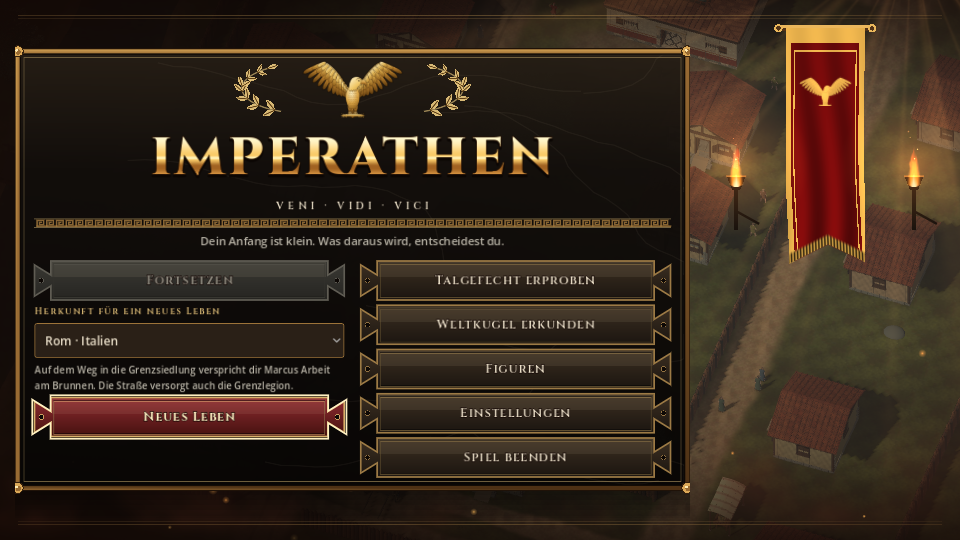
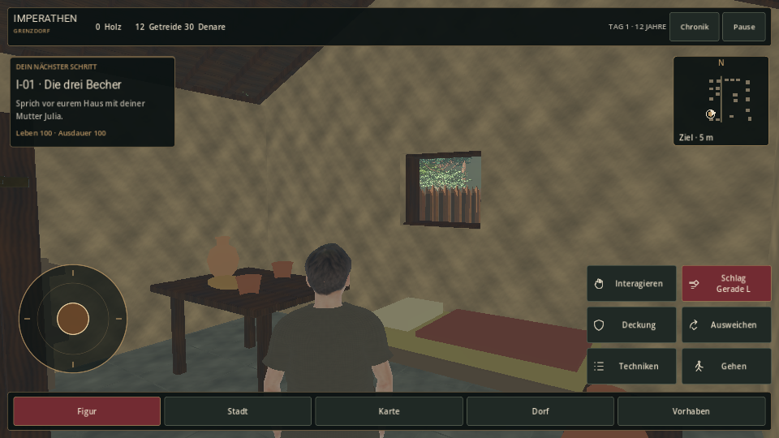
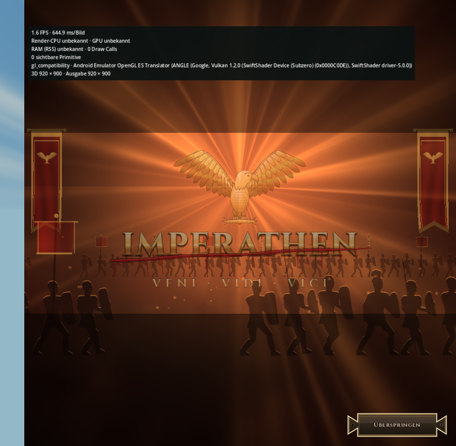

# AP-10 · Android Build 8 · Lieferbericht

Stand: **24.11.2026**. Branch: `feature/ap1-ap2-companions-20261124`.
[Entwurfs-PR #53](https://github.com/Ullmann27/Imperathen/pull/53).

**Die ARM64-APK ist gebaut, mit dem nachgewiesenen Build-7-Bestandsschlüssel
signiert und zur Geräteprüfung bereitgestellt.** Der automatisierte Android-Lauf
ist erfolgreich. Die Abnahme auf einem physischen Fold7 und der vollständige
Android-Durchlauf I-00 bis I-14 bleiben offen; AP-10 ist deshalb noch nicht
vollständig abgeschlossen.

## 1. Ausgelieferte Datei

| Merkmal | Nachgewiesener Wert |
|---|---|
| Datei | `IMPERATHEN-b2c5970e-arm64.apk` |
| Version | `0.8.0-companions`, Versionscode **8** |
| Paketkennung | `at.heinz.imperathen` |
| Architektur | `arm64-v8a` |
| Größe | **186.142.729 Bytes**, etwa 186,1 MB bzw. 177,5 MiB |
| Quellcommit der APK | `b2c5970e7c8ce032c1941464e7659ac6d515c854` |
| Engine / Renderer | Godot `4.7.2.stable.official.ed1daf0bf` / `gl_compatibility` |
| Pakettyp | Debug-Prüfbau; kein Store-Release |
| Android-Manifest | min SDK 24, target SDK 36; keine angeforderten Berechtigungen |

SHA256 der **fertigen, ausgelieferten** APK:

```text
03f76c9e9a16c50f372ce63d56eb32770382256b809fcd9bd2e0a047b241972e
```

Der Dateidownload wurde im zugehörigen Chat bereitgestellt. Die APK liegt wegen
ihrer Größe nicht im Git-Repository. Die Android-Artefakte des CI-Laufs enthalten
den ursprünglichen Export mit dessen temporärer CI-Signatur; sie sind nicht mit
der hier bezeichneten Auslieferungsdatei gleichzusetzen. Nachfolgende reine
Dokumentationscommits ändern den oben angegebenen APK-Quellcommit nicht.

Belege: [Buildbericht](evidence/apk/IMPERATHEN-b2c5970e-arm64.build.json),
[Prüfsumme](evidence/apk/IMPERATHEN-b2c5970e-arm64.apk.sha256) und
[Herkunft der Bau- und Laufzeitartefakte](evidence/run85-provenance.json).

## 2. Spielinhalt und technische Änderungen

Die APK enthält den zuvor gelieferten AP-1/AP-2-Stand: Silvanus begleitet den
Spieler in I-04; Marcus begleitet ihn in I-06, I-08 und I-09. Die Figuren nutzen
ihre tatsächlichen Positionen für Interaktionen. Der sichtbare Rollenname in
I-07 lautet „Wachmann“, während die technische ID `severus` erhalten bleibt.
Neun vorhandene Brückenschritte für I-02, I-08 und I-10 bis I-14 stehen in sieben
Missionsdateien. Handlung, Fundstellen und technische Ergänzungen sind im
[AP-1/AP-2-Lieferbericht](../24_ap1_ap2/DELIVERY.md) und in der
[Quellenprüfung](../24_ap1_ap2/QUELLENPRUEFUNG.md) dokumentiert.

Dieser Android-Schritt erhöht die Paketversion auf 8, aktiviert den Bau auf dem
Entwicklungsbranch und erweitert die Exportprüfung um alle vierzehn Missionen,
die drei Begleitmodule sowie eindeutige Signaturnachweise. Das neue Werkzeug
`tools/resign_android_apk.py` prüft Herkunft, Nutzdaten und Bestandssignatur der
Ausgabedatei. Die CI-Prüfwerkzeuge sind ausdrücklich auf Build-Tools 35.0.1
festgelegt; die lokale abschließende Signierung verwendet dokumentiert 35.0.0.

Spielstände bleiben bei Schema v5 mit Envelope und `screenplay.version = 3`.
Gegenüber dem bereits grafisch geprüften Spielstand `0ecf498` unterscheiden sich
die Dateien unter `prototype/` ausschließlich in Versionscode und Versionsname.
Es gibt in diesem Bauschritt keine neue Grafikänderung.

## 3. Ausgeführte Prüfungen

| Prüfung | Ergebnis und Reichweite |
|---|---|
| Python, vorgeschriebener Gesamtlauf | **224/224 bestanden**, lokal und im erfolgreichen CI-Lauf |
| Godot 4.7.2, vorgeschriebener Gesamtlauf | **64/64 Gruppen bestanden**, lokal und im CI-Lauf; keine Warnungen im abschließenden lokalen Bericht |
| Ursprüngliche CI-ARM64-APK | **30/30 statische Paketprüfungen bestanden** |
| CI-x86_64-APK | **30/30 statische Paketprüfungen bestanden** |
| Fertige ARM64-APK mit Bestandssignatur | **31/31 statische Paketprüfungen bestanden**, einschließlich festem Zertifikatabgleich |
| Android-Laufzeit | **86/86 protokollierte Prüfschritte bestanden**, keine protokollierten Spiel-Laufzeitfehler |
| Nutzdatenvergleich vor/nach Signierung | **1.278 Dateien bytegleich**, jeweils Name, Größe und SHA256 geprüft |
| Aufnahmen im Android-Bericht | **17 Originalbilder** erfasst; drei ausgewählte Bilder unten zusätzlich im Repository |

Die Zahlen werden nicht addiert: Engine-Gruppen enthalten mehrere Einzeltests,
und der Android-Bericht zählt auch wiederholte Dialogfortschritte. Seine 86
Prüfschritte besitzen 84 unterschiedliche Namen und enthalten fünf ARM64-Schritte.

Belege: [erfolgreicher Android-Lauf #85](https://github.com/Ullmann27/Imperathen/actions/runs/45446452854),
[abschließender lokaler Godot-Bericht](evidence/delivery-engine-report.json),
[lokaler Prüfabschluss](evidence/delivery-gate.json),
[fertige APK-Prüfung](evidence/apk/IMPERATHEN-b2c5970e-arm64.validation.json) und
[unveränderter Android-Laufzeitbericht](evidence/android/runtime-report.json).

Auf dem APK-Quellcommit sind auch die drei übrigen Prüfabläufe erfolgreich:
[Foundation](https://github.com/Ullmann27/Imperathen/actions/runs/45446471084),
[Story/Cinematics](https://github.com/Ullmann27/Imperathen/actions/runs/45446471103)
und [NPC/Assets](https://github.com/Ullmann27/Imperathen/actions/runs/45446471238).

## 4. Was der Android-Lauf tatsächlich belegt

Der ausführliche Ablauf lief auf einem Android-15-Emulator mit API 35,
`sdk_gphone64_x86_64` und x86_64-APK. Er prüfte Start und Hauptmenü, das Öffnen und
Weiterschalten des Prologs I-00 sowie die Überspringen-Funktion bis zur Übergabe
an die Kindheitsaufgabe. Dies ist kein vollständiger Durchlauf des Vorspanns.

Mit echten Android-Zeigergesten wurden die ersten beiden Kindheitsaktionen
erledigt: das Gespräch mit Mutter Julia (`mother_morning`) und das Füllen des
Familienkruges (`fill_water`). Haushaltsmünze und Wasserkrug wurden tatsächlich
erworben. `father_morning` wurde als nächstes Ziel erreicht, nicht erledigt. Der
Test injizierte dafür keine Queststände, Gegenstände oder Spielerpositionen.

Weitere bestandene Schritte betreffen Bewegung und Anhalten nach dem Loslassen,
Gehen/Laufen, das Technikmenü und die Auswahl einer Schlagtechnik, Pause bei
gehaltenem Touch, Hintergrund/Zurückkehr, Prozessneustart und „Fortsetzen“ mit
erhaltenem Fortschritt. Der Bericht prüft außerdem die Anbindung und
Wiederherstellung des NPC-Zustands, geladene Figuren- und Ausrüstungsressourcen,
Talansicht, Marschbewegung, Größenwechsel der Anzeige, Globus und Figurengalerie.
Die Auswahl einer Schlagtechnik ist kein vollständiger Kampftest.

Zusätzlich wurde die ursprüngliche CI-ARM64-APK installiert, als ARM64 ausgewählt
und **unter Übersetzung bis zum gerenderten Vorspann gestartet**. Der ausführliche
x86_64-Spielablauf wurde auf ARM64 nicht noch einmal ausgeführt.

Beim ersten Start erschien ein ANR-Dialog des vorinstallierten **Pixel Launcher**.
Das Testwerkzeug erkannte und schloss diesen Launcher-Dialog, anschließend lief
die Spielprüfung weiter. Dieser dokumentierte Systemvorfall wird nicht als
Spielfehler eingeordnet, aber auch nicht verschwiegen.

### Grenzen der Grafikmessung

Der Emulator meldet ANGLE/SwiftShader als Software-Renderer. Der Kindheitsablauf
verwendet das Grafikprofil `low` („Leicht“), die Talproben `balanced`. Die zwölf
kurzen Talintervalle umfassen insgesamt nur 22 Frames; ihre protokollierten
Bildraten liegen ungefähr zwischen **0,46 und 2,62 FPS**. Das ist weder ein
belastbarer Leistungsbenchmark noch eine Messung des Fold7. GPU-Frametimes und
RSS sind in diesen Talproben nicht vorhanden. Es wird daraus keine Smartphone-
Bildrate, thermische Stabilität oder hohe Grafikqualität unter Dauerlast abgeleitet.

## 5. Signatur und Aktualisierung

Genau ein von `apksigner` verifiziertes Zertifikat signiert die fertige Datei.
Sein SHA256 ist identisch mit der veröffentlichten Build-7-APK:

```text
a41d5810bcc3214bc4c8d29dcd1899210db37b82a03dec21b3c43552357ae215
```

Die Identität wurde gegen die tatsächliche veröffentlichte Build-7-Datei geprüft;
der [Nachweis](evidence/build7-signing-proof.json) nennt deren Hash und Quelle.
Private Schlüssel und Keystores sind nicht Bestandteil dieses Repositorys.
Welche Datei auf dem privaten Fold7 installiert ist, wurde nicht ausgelesen.
Ein tatsächlicher Updateversuch Build 7 → Build 8 wurde hier nicht durchgeführt.

Die Laufzeitprüfung gehört zu den ursprünglichen CI-Dateien. Für ARM64 lautet
deren SHA256 `03da2d5a927c631a5e509b6c85e80a04a43f6e283bdf1a6883512eba086cfc6d`.
Nach dem Signieren lautet der vollständige APK-Hash anders, obwohl die 1.278
Spiel- und Engine-Dateien identisch sind. Die fertige neu signierte APK wurde
anschließend **nicht erneut installiert oder gestartet**. Der Laufzeitbericht
wurde nicht auf ihren neuen Hash umgeschrieben.

Der [Signierbericht](evidence/apk/IMPERATHEN-b2c5970e-arm64.signing.json)
enthält das vollständige Nutzdatenverzeichnis und den verwendeten Werkzeugstand.
Eine zweite unabhängige Prüfung hat APK-Hashes, alle 1.278 Nutzdaten sowie
Manifest, Quellzuordnung und Signaturnachweise nochmals abgeglichen.

## 6. Bilder und bekannte Grenzen

Die sichtbaren AP-1-Änderungen haben bereits **neun Vorher-/Nachher-Paare aus
identischen Kameras** im [vorangegangenen Bildnachweis](../24_ap1_ap2/DELIVERY.md).
Die nachfolgenden drei Bilder stammen unverändert aus Lauf #85 und wurden
visuell geprüft. Sie zeigen den tatsächlichen Emulatorstand; sie sind keine
neuen Vorher-/Nachher-Paare und kein Nachweis einer Grafikverbesserung.

### Hauptmenü · x86_64 · 960 × 540



**Bekannte ältere Text-Unstimmigkeit:** Bei „Rom · Italien“ beschreibt der
Herkunftstext noch den früheren Beginn mit Marcus, Grenzsiedlung und Brunnenarbeit.
Die Kampagne startet tatsächlich mit I-00 und der Familienkindheit. Der Text in
`prototype/scripts/strategy/origins.gd` ist gegenüber dem Handoff unverändert
(Git-Blob `9165807ae3c6d053b070af18d2d7cd923919c699`). Eine spätere gezielte
Textkorrektur ist separat vorzusehen; diese APK enthält sie noch nicht.

### Familienhaus · x86_64 · Profil „Leicht“ · 960 × 540



### ARM64-Start unter Übersetzung · 920 × 900



Die neuen Begleitstellen I-04/I-06/I-08/I-09 und der vollständige Missionsweg
I-02 bis I-14 wurden in diesem Android-Lauf nicht durchgespielt. Die portable
Godot-Prüfung deckt zugehörige Logik, Begleitphysik, Missionszweige und Speichern/
Laden ab; sie ersetzt keinen entsprechenden Android-Spieltest. Auch eine
90-Stunden-Kampagne ist mit dieser Lieferung nicht nachgewiesen.

## 7. Nächster überprüfbarer Schritt

Der [Fold7-Prüfplan](FOLD7_PRUEFPLAN.md) nennt die konkrete APK, erwartete
Beobachtungen und auszufüllende Ergebnisse. Zunächst Installation als Update und
„Fortsetzen“ mit vorhandenen App-Daten prüfen. Bei einem Paket- oder
Signaturkonflikt die vorhandene App samt Daten behalten und den genauen Fehlertext
festhalten. „Neues Leben“ ersetzt den aktiven Spielstand; deshalb einen wichtigen
Stand zuerst prüfen und sichern, bevor ein neuer Testdurchgang beginnt.

Danach folgen Touch und Anzeigewechsel, die vier Begleitstellen samt Speichern/
Laden und erst anschließend längere Grafikmessungen mit festen Bedingungen.
**Zu Bildrate, Wärmeentwicklung, Akkuverbrauch und Dauerstabilität auf dem
tatsächlichen Fold7 liegen mir keine gesicherten Daten vor.**

Die erste CI-Störung und ihre behobene Werkzeugursache stehen im
[Bau- und Signierungsbericht](BAU_UND_SIGNIERUNG.md). Der PR bleibt ein Entwurf
auf Basis von `handoff/sol-20261124`; `main` wurde nicht geändert.
