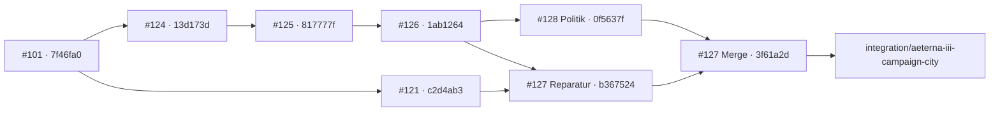

# Aeterna III · Marktbesuch in der laufenden Kampagne

Die Kampagnenpause bietet nach „Die drei Becher“ den Stadtmarkt an. Der Besuch setzt am Marktviertel ein, die Rückkehr am bisherigen Dorfstandort. Es gibt für diese Verbindung noch keine durchgehend bereisbare Straße. Bei einem laufenden Überfall oder einer ausstehenden Geschichtsentscheidung bleibt die Kampagne am Ort. Die freie Stadterkundung im Hauptmenü behält ihren bisherigen isolierten Spielstand.

## Gemeinsame Grundlage



Die beiden Eltern von `3f61a2d9080b6c1df5dfae87cf9dd7f33530b792` enthalten den früheren Reparaturkopf und den vollständigen politischen Kopf. #96 und #122 sind ebenfalls Vorfahren. Der Zweig enthält einzeln übernommene Arbeit aus #118 und den Epochenfilter für das ältere Stadtmodell. #116, #117, #119 und die komplette spätere Kolosseum-Baustufe aus #120 bleiben eigenständige Arbeitszweige. Private Figuren, Modelle und Audioaufnahmen behalten ihre bisherigen Herkunfts- und Veröffentlichungsregeln.

## Schnittstellen

| Bereich | Eigentümer im Code | Vertrag |
|---|---|---|
| Ort und Zeit | Main, CityExploration, WorldModel | Ein Besuch verwendet das bestehende Modell, dieselbe Uhr und denselben Speicherpfad. Pro Spielsekunde vergeht eine Kalendersekunde. „1 Std. warten“ lässt die Simulation budgetiert aufholen. Ein Geschäft dauert wie bisher 30 Spielminuten. |
| Beutel und Handel | CityMarketBridge, WorldModel, CityLifeSession | Vor dem Buchen prüfen Standort, Befehl, Zeit, Anwesenheit, verfügbare Mittel und Ware den Vorgang. Erst nach dem bestätigten Schreiben übernimmt die Sitzung den neuen Stand. Wiederholungskennung und Generation schützen vor Doppelbuchung und veralteten Ansichten. |
| Wirtschaft | CityLife und CityTrade | Zehn Katalogwaren sind lokalen Betrieben zugeordnet. Für diese Waren gelten der Betriebsbestand und die Betriebskasse. Katalogpreise bleiben in Denaren angegeben. Pferde, Wasser und weitere Ausrüstung verwenden weiterhin ihren vorhandenen Katalogvertrag. |
| Speicherung | CityCheckpoint im WorldState | Die Stadt liegt als versionierter, komprimierter Zustand im Kampagnenslot. Das Dorf behält seine eigenen Ortskoordinaten. Frühere Kampagnen ohne Stadt gründen ihre Bevölkerung beim ersten Besuch. Ein beschädigter Hauptslot kann auf einen vollständigen Sicherungsstand zurückfallen. |
| Personen | CityLife, CityPopulation, CityResidentView | Sichtbare Erwachsene erhalten die ID, Herkunft, Altersgruppe und Erscheinungsvariation des gespeicherten Einwohners. Die Darstellung scannt pro Physiktakt höchstens 24 Kandidaten mit einem Suchbudget von 450 µs zwischen Abfragen. Einzelschritte können das Budget überschreiten. Die vier Profile begrenzen die sichtbare Auswahl auf 3, 6, 9 oder 12 Körper. |
| Wege | bake_city_layout, CityStreets | Der Graph erhält seine alten Anker-IDs, ergänzt die Viertel und prüft die neuen Verbindungen mit Körpermaßen. Das Rendering prüft vor dem Einblenden zusätzlich Boden und freien Raum. Entfernte Einwohner bewegen sich nach dem Straßengraphen. |
| Licht und Waren | VillageLook, CityBakeryDisplay | Dorf und Kampagnenstadt benutzen dieselbe saisonale Sonnenbahn. Der Stadtmarkt aktualisiert Himmel, Licht und Dunst zur gespeicherten Ortszeit. Sechs einzeln sichtbare Brotlaibe spiegeln den tatsächlichen Bestand bis zur Größe der Auslage. Die Kollision des ursprünglichen Tresens bleibt wirksam. |

## Herkunft und räumliche Abnahme

Das neue Sonnensegel, die Holzstützen und die Brotpräsentation sind eigene, historisch inspirierte Spielgrafik. Die gekerbten Laibe verwenden die vorhandene Projektgeometrie aus `tools/city_detail/architecture_generate.py`. Das Skript `tools/world/build_market_bakery.py` exportiert die Blender-Geometrie in Metern nach `prototype/assets/city/bakery/market_bakery.glb`. Die Kampagnenszene ersetzt ausschließlich die bisherige Warenfläche am verifizierten Bäckerstand. Von sechs Laiben können einzeln Proben entfernt werden. Das Mobiliar dient weiterhin demselben Geschäft.

Die Arbeit am nördlichen Pflasteranschluss umfasst das Blender-Quellmodell, das sichtbare GLB und die zugehörige geneigte Kollision. Der dokumentierte Quartierlauf beginnt am Forum und führt über sieben Ziele bis zum Stall.

## Wiederholung

```sh
python3 tools/check_prototype.py --only city_life city_market_bridge city_campaign_trade campaign_market_visit quarter_street_walk --report /tmp/imperathen-stadt
blender -b -t 2 --python-exit-code 1 -P tools/world/build_market_bakery.py
```

Für den grafischen Besuch wird derselbe Godot-Test mit einem frischen, leeren XDG-Datenverzeichnis, `IMPERATHEN_ISOLATED_TEST=1`, `--rendering-method gl_compatibility` und `-- --capture-dir=/absoluter/pfad` ausgeführt. Er lädt die bestehende I-02-Migrationsfixture, nutzt den normalen Pausenknopf, wartet auf besetzte Stände, geht zur Bäckerei und kauft über den tatsächlichen Dialog. Die 30 Denare des Ausgangsspielstands gehören dieser Testfixture. Neue reguläre Kindheitsspiele beginnen weiterhin mittellos. Die spielbaren Stadt-GLBs müssen zum Import bereitstehen.

## Offene Abnahme

Der Marktbesuch speichert den Handel, die Weltzeit und das Stadtleben. Nach einem Neustart beginnt der Spieler wieder im Dorf. Eine Wiederaufnahme auf demselben Pflasterstein, ein vollständiger Weg zwischen Städten und die Darstellung der Kinder und Innenraumtätigkeiten der Stadtbevölkerung stehen aus. Bei Epochenübergängen mit wegfallenden bewohnten Ankern benötigt die Stadt eine Umsiedlungsregel. Die dauerhafte Wärmeentwicklung, Laufzeit und Speicherlast auf einem physischen Fold7 bedürfen noch einer Gerätemessung.
