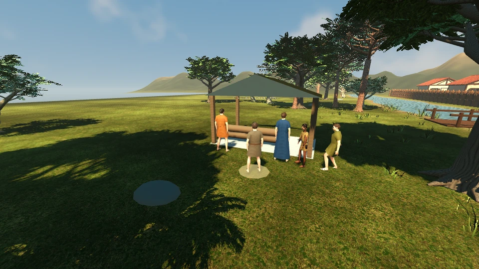
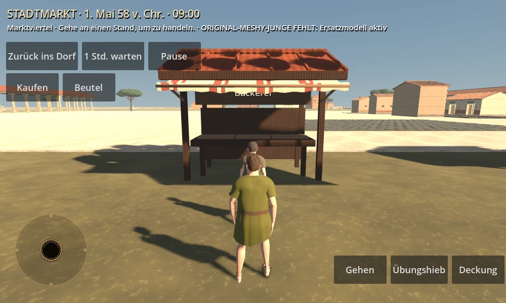

# Gemeinsame Wege durch Valdora

Marcus und Silvanus können in I-04 denselben Holzauftrag begleiten. Wer einen Weg erkundet oder die Last trägt, geht selbst zum Holzlager. Sextus nimmt am Ende das eine Bündel entgegen, das im ursprünglichen Auftrag verzeichnet ist. Verabschiedet sich der Träger unterwegs, kann der Spieler es allein oder mit dem verbliebenen Gefährten abliefern.



## Von der Bitte zur tatsächlich geleisteten Arbeit

1. Das Gefolgebuch unter `world_state.party.members` verweist auf Personen aus der gemeinsamen Registrierung. Der bisherige Freund verwendet in sämtlichen Herkünften `pc:companion`. Das Dorf behält für Silvanus seinen Schlüssel `vil:silvanus`. Auch bei Entlassung und Tod bleiben Besitz, Erinnerungen und Biografie mit dieser Person verbunden.
2. `companion_world.gd` übergibt die vereinbarte Aufgabe an den vorhandenen physischen Körper. Zum Folgen verwendet die Gruppe zeitversetzte Punkte auf dem tatsächlich gelaufenen Spielerweg. Die lokale Suche in `companion_follow.gd` prüft Kapsel und Boden, plant mit begrenztem Aufwand neu und bewegt über die normale Godot-Kollision. Wer auf einer schmalen Hausrampe warten soll, geht dafür seitlich aus dem Eingang.
3. `GameWorld.npc_observations` liefert sichtbare Körperpositionen für die Prüfung durch das Modell. Das Dorf speichert sie in `village.behavior.people`. Ältere regionale Karrieren ohne Dorfverhalten dürfen die tatsächlich beobachtete letzte Position im Personeneintrag unter `travel_position` speichern. Bei Wa bleibt so Aki auch nach dem Laden an seinem Ort.
4. Jede unterstützte Missionsdatei nennt die zulässigen Rollen pro Schritt in `party_tasks.steps`. Die Metadaten kennzeichnen die kreativen Erweiterungen. Sie stehen bei der ursprünglichen Mission und können um weitere Rollen ergänzt werden. Nach einem erfolgreich abgeschlossenen Schritt prüft das Modell Auftrag, Eignung und eine Entfernung von höchstens 3,5 Metern zum Ziel. Zeitgesteuerte Arbeit zählt beim Abschluss. Die sichtbaren Rückmeldungen greifen auf den tatsächlich beteiligten Namen zurück.
5. Das Dorf führt Gesundheit, Arbeitsplatz und Überleben der erwachsenen Einwohner im vorhandenen Wirtschaftsroster. Eine Ration auf Reisen unterstützt die Erholung, fehlende Mahlzeiten schwächen die Person. Unter 31 Gesundheitspunkten unterbricht sie den Auftrag und erholt sich zu Hause. Die dortige Mahlzeit nutzt wieder dieselbe Dorfwirtschaft. Die Figurenansicht, Reiseauswahl und Missionsgutschrift konsultieren diesen Zustand.

| Abschnitt | Spielbare Beiträge aus der Gruppe |
| --- | --- |
| I-04 | Weg zum Holzlager und zur Schmiede erkunden, beim Aufnehmen und Liefern helfen |
| I-06 | Cassias Stand finden und die Lieferung mitprüfen |
| I-07 | Medizin tragen oder bei der Übergabe helfen, den Krug zum Torposten mittragen |
| I-08 | Die vorhandenen Hufspuren beobachten oder ihren Verlauf lesen |
| I-09 und I-10 | Die Familie kehrt für die Nacht zu ihrer Verpflichtung zurück. Der Spieler entscheidet am Haus persönlich zwischen den bestehenden Wegen. Gefolge und Marktbesuch setzen während der geschützten Entscheidung aus. |
| I-11 bis I-13 | Sextus, Silvanus und gegebenenfalls Julia scheiden mit dem ursprünglichen Storyereignis aus. Überlebende können am folgenden Morgen mit Aurelia Verletzte und Schäden erfassen. |

Die übrigen Abschnitte der vier Bände nutzen weiterhin ihre vorhandenen Missionsbedingungen. Der aktuelle Spielstand implementiert die oben aufgeführten orts- und rollengebundenen Aufgaben. Vollständige Gruppenregie für alle 113 Abschnitte steht aus.

## Spätere Aussöhnung

Ein ungelöster Streit in I-03 kann Marcus zunächst von der Reisegruppe fernhalten. Nach der tatsächlich abgeschlossenen Lieferung an Sextus lässt sich Marcus persönlich auf sein gebrochenes Tragegestell ansprechen. Auf die Zusage folgt die Übergabe von zwei Holz aus dem eigenen Vorrat. Danach kann der Spieler ihn um Begleitung bitten. Die spätere Hilfe bleibt als Erinnerung erhalten. Die ursprüngliche Wahl und die zugehörigen Szenen in I-03 bleiben nachvollziehbar. Der regionale Lebensweg öffnet dieselbe kreative Begegnung nach der ersten tatsächlich vorgenommenen Holzbeschaffung für die dortige Bezugsperson.

## Übergang zum Stadtmarkt

An der Abreise können gesunde Mitreisende im Abstand von höchstens acht Metern mitkommen. Das Spiel löst die Dorfansicht aus dem Szenenbaum. `city_party_visit.gd` übernimmt die bereits vorhandenen Körper, sucht einen freien Platz am Stadteingang und führt sie auf den Kollisionen der echten Marktstraße. Wartende bleiben am Dorfanker. Bei der Rückkehr erhält der ursprüngliche Dorfknoten seinen Körper mit Position und Kollisionsmaske zurück. Während des Marktbesuchs speichert die Kampagne weiterhin ihren Dorf-Rückkehrpunkt.



## Messungen mit Godot 4.7.2

| Lauf | Beobachtung |
| --- | --- |
| `party_world_test.gd` | Im Holzauftrag läuft Marcus 41,276 m und Silvanus 35,119 m in 671 Physikschritten. Der größte Schritt beträgt 0,0684 m. Nach Entlassung des Trägers legt Marcus bis zur Schmiede 86,856 m zurück. Der Test speichert beide Personen am Holzlager, liest den Save über den regulären Lader und vergleicht Auftrag, Fähigkeiten, Erinnerungen und Standorte. |
| `party_world_test.gd`, Familienhaus | Marcus erreicht die vorhandene Rampe, räumt sie nach einer Wartebitte und geht danach ins möblierte Haus. Gemessene Fußhöhe 0,353 m, nominale Bodenkante 0,3925 m. |
| `party_city_test.gd` | Silvanus folgt vom Stadteingang zum Bäcker 3,980 m. Größter Schritt 0,0384 m, Endabstand zum Spieler 1,771 m. Der Prüfer vergleicht beim Szenenwechsel die Godot-Objektidentität und den Dorfrückkehrpunkt. |
| `party_aftermath_test.gd` | 46 von 46 Prüfungen. Julia, Sextus und Silvanus sind vor dem Überfall persönlich aufgenommen. Die I-10-Entscheidung lässt sich weder auf dem Markt noch beim entfernten Vater auslösen. Silvanus geht 29,966 m zur Familie. Anschließend bleiben die Toten beim Laden ohne sichtbaren Körper und ohne Kollision. Varro geht 35,235 m zu Aurelia und sammelt am nächsten Morgen Wahrnehmungserfahrung. Ein kontrollierter Verletzungszustand prüft zusätzlich Wundversorgung, Erholungsunterbrechung und Dorfmahlzeit am selben Personenwert. |
| `party_reconciliation_test.gd` | 28 von 28 Prüfungen. Der Lauf lädt den aufgezeichneten alten Rivalen-Spielstand, spielt die Aussöhnung im normalen Dialog und prüft identische alte I-03-Wahl, Wortlaut der Erinnerungen, freiwilligen Beitritt, einmaligen Holzverbrauch und erneutes Laden. Dasselbe Verfahren funktioniert im regionalen Wa-Spiel mit Aki. |
| `quarter_street_walk_test.gd` | 127,45 m Spielerweg im generierten römischen Stadtmodell. Sieben Ziele erreicht, in null Schritten verloren die Füße den Boden. |
| `npc_behavior_ui_test.gd` | 20 von 20 Prüfungen. Die Datei `tests/fixtures/decimus_pr127_v6.json` wurde mit `new_game("italia", true)` und `WorldModel.save_game` im Stand `3f61a2d9` erzeugt. Die heutige Version lädt den ursprünglichen Envelope samt SHA-256, erhält den ersten Decimus-Dialog und bietet seinen politischen Dorfauftrag nach dem persönlichen Kennenlernen an. Der ursprüngliche UI-Test auf diesem alten Commit bestand 13 von 14 Prüfungen. |
| `mission_bridge_data_test.gd` | 224 von 224 Prüfungen der gespeicherten Schritte, Drehbuchbrücken und drei älteren, tatsächlich aufgezeichneten Spielstände. |

Die beiden Standbilder stammen aus dem laufenden Godot-Viewport. Für das Holzlager schiebt der Prüflauf die gemeinsame Kampagnenuhr um sechs Stunden weiter. Für die Marktaufnahme verwendet er viermal die bestehende Warteaktion. Die Dorfmessung setzt die Spielfigur an den Gesprächs- und Übergabepunkten ein. Die Wegstrecken der Gefährten entstehen in der Physiksimulation. Beim Straßenlauf gehen Spieler und Gefährte mit den gewöhnlichen Bewegungsfunktionen.

Die Teststadt lässt sich aus den vorhandenen Blender-Quellen mit dem Ablauf für das QA-Paket erzeugen. Jeder Godot-Lauf benötigt ein eigenes Datenverzeichnis.

```sh
run_dir=$(mktemp -d)
export XDG_CONFIG_HOME="$run_dir/config" XDG_DATA_HOME="$run_dir/data" XDG_CACHE_HOME="$run_dir/cache"
export IMPERATHEN_ISOLATED_TEST=1
godot --headless --path prototype --fixed-fps 60 --script res://tests/party_world_test.gd
```

[Bedienung und Aufnahmen aus der Gefährtenansicht](GEFAEHRTEN_ABNAHME.md)
