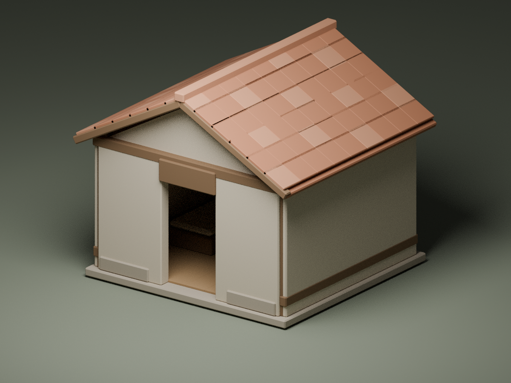

# IMPERATHEN – Grenzdorf

Ein ausführbarer, bewusst begrenzter 3D-Funktionsprototyp für den Anfang des Lebenswegs. **Android ist die Hauptplattform.** Die größere Vision bleibt in der Projektmappe beschrieben; dieses Kapitel verbindet ihre ersten Systeme tatsächlich miteinander.

## Auf Android anfangen

Die **ARM64-APK ist bereits exportiert**. Download, Prüfsumme, Installationsschritte und der jeweils aktuelle Testnachweis stehen in der [Android-Installationsanleitung](../docs/10_development/ANDROID_INSTALL.md). Der [zugehörige Android-Lauf](https://github.com/Ullmann27/Imperathen/actions/runs/45038377950) ist erfolgreich: Installation, Menü, neues Spiel per Touch, Android-Zurück/Pause und App-Wechsel im x86_64-Emulator. Eine Prüfung auf einem echten ARM64-Handy ist ebenfalls noch nicht nachgewiesen. Ein Emulatorlauf für eine andere Prozessorarchitektur ersetzt diese Geräteprüfung nicht.

1. Öffne die Installationsanleitung und lade die dort verlinkte ARM64-Testfassung für dein Androidgerät herunter.
2. Installiere die APK nach den dort beschriebenen Schritten. Zum Spielen werden auf dem Handy weder Godot-Editor noch Blender, Python oder ein KI-API-Schlüssel benötigt.
3. Starte **IMPERATHEN im Querformat**. Der Vorspann lässt sich mit **Überspringen** beenden.
4. Wähle **Neues Leben**. **Fortsetzen** ist verfügbar, sobald ein Spielstand vorhanden ist.
5. Bewege die Figur mit dem linken Analogpad. Rechts findest du **Interagieren** und **Angreifen**. Der nächste Schritt steht im Zielpanel; **Chronik** öffnet die ausführlichen Angaben.

Diese APK ist eine Testfassung des unten beschriebenen Abschnitts. Sie enthält keine laufende Cloud-KI und benötigt zum Spielen keine Modell-API. Der Editorstart für die Entwicklung steht weiter unten.

## Spielweg

Du beginnst mit zwölf Jahren in einer bereits existierenden Grenzsiedlung. Du besitzt noch kein Holz und keine eigene Hütte. Eine erlaubte Baufläche und ein geliehenes Werkzeug ermöglichen den Anfang. Das vorhandene Dorf gehört zur Umgebung; deine neue Unterkunft entsteht erst durch deine Arbeit.

1. Gehe zu den beschrifteten Holzvorräten westlich und nördlich des Weges. Jede erfolgreiche Interaktion nimmt vier Holz aus einem endlichen Vorrat. Sammle zunächst zwölf Holz, wenn du Marcus helfen möchtest.
2. Sprich mit Marcus nahe dem Brunnen. Vier Holz zu teilen erhöht sein Vertrauen; eine Ablehnung wird ebenso als tatsächliche Entscheidung gespeichert.
3. Wähle **Hütte**. Platziere die Hütte durch Antippen auf der markierten Fläche östlich des Dorfwegs. Ein Bau verbraucht acht Holz; belegte oder unzulässige Plätze werden abgelehnt.
4. Wähle **Figur**, um zur persönlichen Ansicht zurückzukehren, und bleibe nahe der Baustelle. Der Prototyp benötigt zwölf Sekunden anwesender Arbeit. Entfernst du dich oder pausierst das Spiel, entsteht kein heimlicher Baufortschritt. Bei mehreren Baustellen steht insgesamt nur die Arbeit einer Person zur Verfügung.
5. Nach fertiger Hütte und entschiedenem Treffen gehst du zum Übungsplatz. Der ausdrücklich beschriebene Übergang **sechs Jahre später** macht dich und Marcus erwachsen. Das ist eine kurze Darstellung für den Funktionstest; der spätere lange Jugendabschnitt ist noch nicht implementiert.
6. Triff das Übungsziel über **Angreifen** dreimal mit gültigem Abstand und Erholung zwischen Schlägen. Danach kannst du über **Truppe +** bis zu drei Freiwillige für je fünf Denare und zwei Getreide anwerben. Sie fehlen anschließend als zivile Arbeitskräfte.
7. Wähle **Verteidigen**. Drei Gegner stehen nördlich des Dorfes. Nähere dich und kämpfe persönlich; außerhalb der Reichweite oder während der Schlagpause zählt kein Treffer. Gegnerzustände und Verluste bleiben über Kamerawechsel und Speichern erhalten.
8. Nach dem Sieg entscheidest du zwischen Schutz der Siedlung und Verfolgung nach Norden. Diese Auswahl verändert Ressourcen, Vertrauen und Folgetext. Damit ist dieser Prototypabschnitt abgeschlossen. Er legt keine endgültige Karrieregrenze für das spätere Gesamtspiel fest; die Kaiserkarriere gehört noch nicht zu dieser Fassung. Erkunden und Speichern bleiben möglich.

Wirst du im Gefecht besiegt, endet dieser Lebensbogen. Das Hauptmenü erlaubt einen neuen Anfang. Das ist ein tatsächlicher Misserfolgszustand dieses Abschnitts, keine fertige Simulation aller späteren politischen Karrierewege.

## Touchbedienung und Android-Zurück

| Aktion | Android-Bedienung |
| --- | --- |
| Figur bewegen | Linkes Analogpad ziehen; Loslassen stoppt die Bewegung. |
| Kamera drehen | Im freien Weltbereich ziehen. |
| Sammeln, ansprechen oder Ausbildung beginnen | Nahe an das Ziel gehen und **Interagieren** wählen. |
| Angreifen oder üben | **Angreifen**; gleichzeitig mit dem Analogpad bedienbar. |
| Hütte planen | **Hütte** wählen. |
| Bauplatz bestätigen | Eine freie Stelle im markierten Baugebiet antippen. |
| Bauplan abbrechen | **Bau abbrechen** oder Android-Zurück. |
| Ansicht wechseln | **Figur**, **Stadt** oder **Karte**. Die Figur wird dadurch nicht versetzt. |
| Ziele, Figur, Truppe und Ereignisse nachlesen | **Chronik**; die Welt ist währenddessen pausiert. |
| Pause öffnen | **Pause** im HUD oder Android-Zurück, wenn kein Bauplan offen ist. |
| Speichern | Im Pausenmenü **Spiel speichern**. |

Android-Zurück führt aus Einstellungen zum vorherigen Menü zurück und setzt aus der Pause das Spiel fort. Im Hauptmenü öffnet es eine Beenden-Bestätigung. Eine Storyentscheidung wird dadurch nicht automatisch gewählt oder übersprungen; dafür ist eine der sichtbaren Antworten erforderlich.

Touch ist auf Mobilgeräten automatisch aktiv und lässt sich in den Einstellungen umschalten. Bildschirmränder, sichere Anzeigefläche und Größenwechsel werden berücksichtigt; offene Dialoge behalten ihre Auswahlmöglichkeiten. Die automatischen Prüfungen umfassen Touch-Ereignisse, mehrere Finger, Hintergrundwechsel und verschiedene Fenstergrößen. Ein Test auf einem bestimmten Telefon oder Foldable wird ausschließlich im tatsächlichen Android-Prüfnachweis ausgewiesen.

Einstellungen umfassen UI-Größe, reduzierte Bewegung, Lautstärke, Touchanzeige und drei Grafikprofile. Die Profile ändern tatsächlich Darstellungseinstellungen; sie sind noch keine Vermessung bestimmter Mobilchips. Das Spielgeschehen bleibt identisch.

## Speichern und App-Wechsel

Auf Android liegt der Spielstand im internen Speicher der App. **Fortsetzen** lädt ihn beim nächsten Start. Die Oberfläche speichert ihre Einstellungen separat.

Gespeichert wird bei wichtigen bestätigten Entscheidungen, über **Spiel speichern** und während des Spiels regelmäßig nach 45 Sekunden. Beim Wechsel in den Hintergrund wird eine laufende Simulation pausiert und der Stand gespeichert. Gehaltene Touch-Eingaben werden zurückgesetzt. Bei der Rückkehr läuft ein unterbrochener Kampf nicht selbstständig weiter; du setzt das Spiel bewusst fort. Auch in Dialogen und Menüs entsteht kein Baufortschritt.

Schreiben verwendet eine temporäre Datei, prüft deren Inhalt und übernimmt erst dann die neue Datei. Laden prüft Format, Prüfsumme, Typen, Bilanzen, Fortschritt und IDs. Eine beschädigte Hauptdatei kann durch die letzte gültige Sicherung ersetzt werden. Sind beide ungültig, wird die laufende Welt nicht mit unvollständigen Daten überschrieben.

Die Sicherung ist kein Archiv mehrerer Lebensläufe. Eine neue Partie ersetzt die aktive Partie nach Bestätigung. Prüfsummen erkennen Beschädigung und sind kein Schutz gegen absichtliches Editieren durch den Eigentümer der Datei.

## Für die Entwicklung: Editor und Prüfungen

Der folgende Weg dient der Arbeit am Projekt. Zum Spielen der Android-Testfassung genügt die fertige APK aus der Installationsanleitung.

1. Godot **4.7.2** verwenden; diese Version wurde für den Entwicklungsblock ausgeführt.
2. Das Repository beziehungsweise den Entwicklungsbranch herunterladen.
3. Im Godot-Projektmanager `prototype/project.godot` importieren. Der erste Import wandelt GLB und WAV in Engine-Ressourcen um.
4. **F5** startet `main.tscn`, Vorspann und Hauptmenü. Alternativ im Repository: `godot --path prototype`.

Für die automatischen Headless-Prüfungen: `python tools/check_prototype.py`. Der aktuelle Stand besteht **115 UI-Prüfungen** und **35 Integrationsprüfungen** mit der tatsächlichen Hauptszene. Die Integration prüft jetzt auch das Fenstersignal für Android-Zurück: einmal pausieren, mit dem nächsten Zurück fortsetzen und während des Bauens zuerst die Vorschau abbrechen. Die [UI-Protokolle](../docs/10_development/evidence/ui.log) und [Integrationsprotokolle](../docs/10_development/evidence/integration.log) halten diese tatsächlichen Läufe fest. Die Betriebssystemzustellung auf Android muss zusätzlich durch den APK-Lauf bestätigt werden.

Der [Android-Bauweg](../docs/10_development/ANDROID_BUILD.md) beschreibt Exportvorlagen, SDK, Signierung und Paketprüfung. Ein Headless-Lauf ersetzt keine Prüfung der installierten APK; Bildrate, Temperaturverhalten, Audio und optische Qualität auf dem Handy sind damit nicht vermessen.

Tastatur und Maus bleiben für Entwicklung und die spätere PC-Erweiterung verfügbar: WASD/Pfeile bewegen die Figur, rechte Maustaste und Ziehen drehen die Kamera, E interagiert, linke Maustaste oder Leertaste greifen an. B öffnet den Bauplan; Escape beziehungsweise B brechen ihn ab. Tab und M wechseln die Ansichten. Escape öffnet außerhalb des Bauplans die Pause.

Blender wird zum Neuerzeugen des eigenen Hüttenmodells benötigt; die fertige GLB liegt im Projekt. Keine Engine-Binärdatei ist Teil des Repositorys. Im Editor lässt sich der Benutzerordner über das Projektmenü öffnen: Hauptdatei `imperathen_campaign.json`, Sicherung `imperathen_campaign.json.bak` im `user://`-Verzeichnis.

## Aufbau und derzeitige Grenzen

- `scripts/domain/`: maßgeblicher Weltzustand, Regeln, Kapitel und Speicherung.
- `scripts/world/`: 3D-Darstellung, Kollision, Kamera und Eingaben; sie bucht keine Ressourcen selbst.
- `scripts/ui/`: Menüs, HUD, Dialoge und Eingabeelemente; sie fordert Änderungen über Signale an.
- `scripts/main.gd`: verbindet alle drei Teile, steuert Pause und Speicherung.
- `assets/`: eigenes Hüttenmodell und selbst erzeugter Umgebungston; Herkunft und Hashes im Manifest.

Die regionale Ansicht zeigt dieselbe Dorfwelt aus größerer Entfernung. Eine strategische Provinzkarte, Eroberung, Politik, Handel zwischen Städten, Kaiserkarriere, große Formationsschlachten, eine generative KI-Geschichte, Wochenbalance und Fotorealismus sind noch nicht umgesetzt. Die Gegner stehen aktuell fest und reagieren in Nahkampfreichweite; Rekruten folgen in einer einfachen Formation. Komplexe Wegsuche und vollständige Kampfanimationen fehlen.

Das Bauen umfasst einen Gebäudetyp, die Ressourcen sind begrenzt. Der Regelkern bewahrt höchstens 1024 erfolgreiche explizite Befehlskennungen und 256 Chronikeinträge. Ein unbegrenztes Langzeitspiel benötigt ein anderes Aufbewahrungs- und Fortschrittsmodell. Diese Grenzen sind bewusst sichtbar und werden nicht als fertige Großspielarchitektur ausgegeben.

## Grafikquelle

Die Bilddatei wurde aus der mitgelieferten `.blend`-Quelle gerendert. Sie zeigt das tatsächliche Modell, das auch in Godot importiert wird. Sie ist **kein Ingame-Screenshot**. Die Prototypfiguren und viele Umgebungsobjekte bestehen aus eigener einfacher Geometrie. Das parallel laufende Grafikteam liefert eine getrennte, detailliertere Assetlinie; deren Übernahme erfordert einen eigenen Abgleich.
